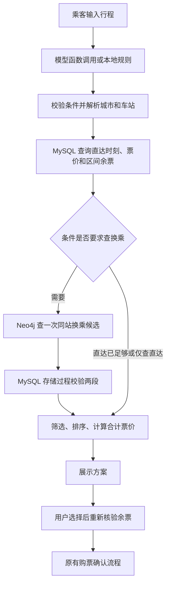
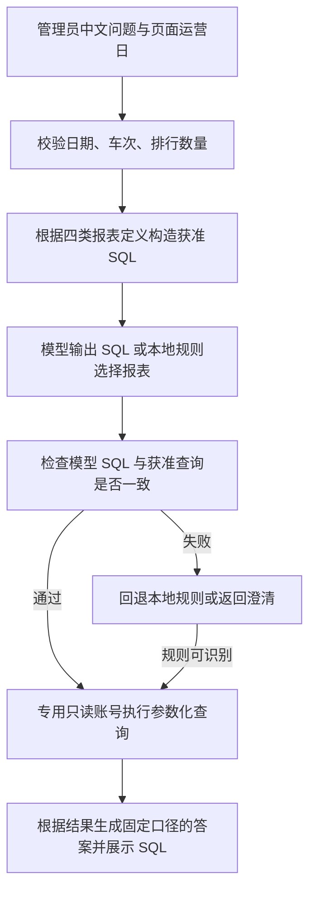

# 铁路客票系统 AI 功能说明

本文对应仓库中已实现的乘客行程助手、管理端运营问答、AI 订票员和异常检测，适合项目交接、课堂演示和功能验收。

## 功能与入口

| 功能 | 页面入口 | 自然语言输入的用途 | 数据来源 |
|---|---|---|---|
| 乘客行程助手 | 乘客首页「我该怎么买？」 | 按起终点、人数、席别、出发和到达时间、预算、车次、车型、用时及换乘要求推荐行程 | MySQL 班次、票价、区间库存，Neo4j 停靠关系 |
| 管理端运营问答 | 管理台左侧「运营问答」 | 常用报表和基于实际视图字段的组合分析，可查看 SQL 和统计依据 | MySQL 运营只读视图 |
| AI 订票员 | 管理台左侧「AI 订票员」 | 用自然语言查余票、预览模拟压测任务；确认后启动 | MySQL 在售产品与席位位图 |
| 管理端异常检测 | 管理台左侧「异常检测」 | 根据确定性规则的检测证据生成解释和人工排查建议 | 库存一致性视图、全库订票缓冲连续采样 |

乘客端默认地址为 `http://127.0.0.1:8080/`，管理端入口为 `http://127.0.0.1:8080/admin-login.html`。初始管理员账号为 `admin`，默认密码为 `RailFlow@123`，实际值以部署配置为准。

四项功能共用模型接口配置。管理端「分析问题」「检测并解释」和「查询并预览」主按钮均带有 **模型 API** 标识。查询和诊断的具体来源可在结果详情中核对。模型负责理解需求、生成查询计划或解释检测证据，票价、库存和运营数字由后端查询数据库取得。

## 启动与模型配置

启动 Docker Desktop 后，在项目根目录双击 `start.cmd`，或执行下列命令。脚本会检查 Python 依赖，首次缺少依赖时自动准备 `.venv`。

```powershell
.\start.ps1
```

`PyMySQL[rsa]` 支持 MySQL 8 新账号的首次认证，Neo4j 驱动用于换乘路径查询。

如需启用外部模型，在启动后端的同一 PowerShell 7 窗口中设置配置。

```powershell
$env:CR12306_AI_API_KEY = Read-Host '输入模型 API Key' -MaskInput
$env:CR12306_AI_BASE_URL = 'https://api.openai.com/v1'
$env:CR12306_AI_MODEL = 'gpt-4o-mini'
.\start.ps1
```

| 环境变量 | 含义 | 默认值 |
|---|---|---|
| `CR12306_AI_API_KEY` | 模型服务密钥，设置后启用模型调用 | 空 |
| `CR12306_AI_BASE_URL` | 兼容接口的基础地址，后端追加 `/chat/completions` | `https://api.openai.com/v1` |
| `CR12306_AI_MODEL` | 服务提供的模型名称 | `gpt-4o-mini` |
| `CR12306_AI_TIMEOUT` | 模型请求超时秒数，取值限制为1至120 | `45` |

接口需要支持 Chat Completions 的 `tools` 和指定函数名的 `tool_choice`。单次模型请求默认超时为45秒，可用上述变量调整。百炼兼容接口会显式传递 `enable_thinking=false`，用于缩短结构化工具调用的响应时间。页面通过本项目后端使用模型。

阿里云百炼已在2026年11月18日使用 `deepseek-v4.1-flash-1017` 完成真实联调。使用已有系统级密钥时，可在启动窗口读取并配置。

```powershell
$env:CR12306_AI_API_KEY = [Environment]::GetEnvironmentVariable('DASHSCOPE_API_KEY', 'Machine')
$env:CR12306_AI_BASE_URL = 'https://dashscope.aliyuncs.com/compatible-mode/v1'
$env:CR12306_AI_MODEL = 'deepseek-v4.1-flash-1017'
.\start.ps1
```

本机本次配置已保存为用户级的 `CR12306_AI_API_KEY`、`CR12306_AI_BASE_URL`、`CR12306_AI_MODEL` 环境变量，并重启服务使其生效。密钥从现有系统变量读取，仓库和测试日志只记录非敏感配置。已打开的终端若仍持有旧环境，可按上面的命令显式读取。

修改代码或模型配置后，需要重启服务。`start.ps1` 检测到健康的已有进程时会复用它，浏览器刷新只能重新加载前端。如果页面已经显示新按钮，但新接口返回 404，先结束旧服务，再运行 `start.cmd`。

## 乘客端购票与行程规划

### 操作流程

1. 在乘客端输入姓名进入首页。
2. 在「我该怎么买？」输入行程需求，或点击示例后提交。
3. 阅读方案中的班次、上下车站、到发时间、席别、分段余票和合计票价。
4. 点击「确认本人车票」或「确认第几段本人车票」，进入原有购票确认页。
5. 核对本人、席别和座位偏好，再提交订单。

可直接试用下面的问题。

> 两个人从南通西到上海虹桥，09:00 到 14:00 出发，人均预算 150 元，下午 3 点前到，可以换乘一次。

当前演示运行日固定为 **2026 年 10 月 14 日**，支持每次查询 1 至 5 人。省略日期和人数时，默认使用演示日和 1 人。起终点支持城市或具体车站，例如“上海”覆盖该城市车站，“上海站”指具体车站。

### 筛选条件与排序

| 输入条件 | 执行方式 |
|---|---|
| 不换乘，或未提出换乘需求 | 查询直达 |
| 可以换乘1次、最多换乘一次 | 查询直达及一次同站换乘，两类各展示至多三条路线 |
| 没票再换乘 | 没有满足全部条件的直达方案时，查询一次换乘 |
| 09:00 后出发、14:00 前出发、09:00 到 14:00 出发 | 筛选乘车日内第一段的发车时间 |
| 人均预算 150 元、总预算 300 元 | 分别限制每人全程票价和所有人全程合计票价，单说「预算」按人均处理 |
| 指定 G8359、首段 G8359 | 直达时限定该班次，允许换乘时限定首段车次 |
| 只坐高铁、只坐动车 | 分别限定每段为 G/C 字头或 D 字头 |
| 全程不超过 2 小时 | 比较第一段发车到最终到站的时间，含换乘等待 |
| 最便宜、优先省钱 | 在每类方案内按票价优先排序 |
| 用时最短 | 在每类方案内按全程耗时排序 |
| 默认 | 在每类方案内按到达时间优先排序 |

直达方案展示在换乘方案之前。同一条路线优先保留排序最靠前的席别组合。换乘等待窗口为 15 至 240 分钟，两段都需要满足人数和席别要求。最晚到达时间对应同一乘车日，跨日到达的方案会受该条件过滤。

### 智能体与数据库如何协作



启用模型时，后端提供 `plan_trip` 工具的参数定义和提取规则。模型返回结构化条件，主要字段如下。

```json
{
  "origin": "南通西",
  "destination": "上海虹桥",
  "date": "2026-10-14",
  "people": 2,
  "depart_after": "09:00",
  "depart_before": "14:00",
  "arrive_by": "15:00",
  "seat": "",
  "max_fare": "150",
  "max_group_fare": "",
  "train_no": "",
  "train_category": "",
  "max_duration_minutes": "",
  "transfer": "allowed",
  "sort": "arrival",
  "clarify": ""
}
```

`transfer` 可取 `direct`、`allowed`、`fallback`，分别表示仅直达、允许一次换乘、没有合适直达时换乘。后端验证字段类型、日期、人数和时间，再调用已有查询。模型提出澄清时，页面显示需要补充的信息。

MySQL 将班次、停靠时刻、票价、席别和座位关联。区间可用座位通过占用位图计算，当座位的 `occupied_mask` 与本次乘车区间掩码按位与等于 0 时，表示全区间空闲。对这些座位计数后检查是否满足同行人数。

Neo4j 的 `TrainRun`、`Station`、`CALLS_AT` 表达班次和停靠站的联系，停靠关系保存站序与到发时间。图查询按时间、车次和车型等条件筛选后返回最多 80 个候选。MySQL 的 `sp_validate_transfer_candidates` 再校验班次、区间、换乘窗口、票价和余票，后端按两段实际票价之和核对预算。预算筛选和价格排序基于已校验的换乘候选集。

### 购票边界与异常处理

| 情况 | 当前行为 |
|---|---|
| 模型接口失败或返回无效参数 | 回退本地规则，结果标明当前模式 |
| 本地规则无法理解完整问题 | 提示改写问题，不执行部分识别出的行程 |
| 请求其他日期、超过5人或超过一次换乘 | 提示修改到支持的范围 |
| 请求连座、指定换乘站或指定第二段车次等暂未支持的条件 | 提示澄清或改写 |
| 未找到满足条件的路线 | 说明当前直达或换乘候选未满足要求 |
| 查询数据库失败 | 页面显示查询失败，可在数据库恢复后重新查询 |
| 选择方案时余票已变化 | 重新核验后提示再次规划 |

多人规划会按人数核验每段余票并显示合计金额，实际购票页每次确认本人的一段车票。同行人分别办理，换乘的两段分别确认。方案查询和进入确认页均不预占库存，最终占座沿用原有订单存储过程及并发校验。

## 管理端运营问答

### 操作流程与统计范围

管理员登录后进入「运营问答」，选择运营日并点击「分析问题」。页面展示自然语言答案、统计范围、统计时间和结果表，并可展开统计口径、SQL 和绑定参数。模型查询会在结果上方展示模式标识，常用报表的回退方式可在 SQL 详情中查看。

常用报表每次查询一个运营日，可指定一个车次。接入模型后，组合分析支持最多 8 个车次、两个运营日的对比或最长 31 天的连续日期范围。省略日期和车次时，使用页面运营日并统计全部车次。问题中写出的 `YYYY-MM-DD` 日期优先于页面日期。运营日对应班次发车日期，订单使用查询时的当前状态，包含演示压测产生的订单。

| 支持的问题 | 示例 | 统计口径 |
|---|---|---|
| 候补区间排行及二等座余票 | G8359 哪个区间候补人数最多？这个区间的二等座还剩多少？ | 同一班次、相同上下车站，累计 `WAITING`、`MATCHING` 请求的 `passenger_count`，覆盖所有席别。另行统计该区间在售二等座的全程空闲座位 |
| 订单状态分布 | 订单状态分布 | 按当前状态分组，对 `order_id` 去重，一笔多人订单算一笔 |
| 已支付订单数 | G8359 已支付订单有多少笔？ | 对当前状态为 `PAID` 的订单号去重，已退款订单排除 |
| 缓冲请求状态分布 | 缓冲请求状态分布 | 每条持久化请求计一次，重试次数不重复计数 |

候补排行支持“前5名”等输入，范围为前 1 至 20 项。“哪个区间”默认取第一项，其余排行默认取前 10 项。候补人数相同按车次、上下车站排序。二等座余票为 0 表示在售产品已无空座，空值表示没有在售二等座产品。

### 组合分析

组合分析可按运营日、车次、上下车站、席别和当前状态分组。车站、席别和状态也可用于筛选。每次查询选择一个指标，最多显示 50 组。当前按本次输入解析条件，追问时需要重新写明要沿用的范围。

| 主题 | 指标 | 示例 |
|---|---|---|
| 订单 | 订单数、已支付订单数、已退款订单数、票项数 | 比较 G8359 和 G1304 的已支付订单数，按车次和席别分组 |
| 候补 | 排队候补人数、候补请求数、已兑现候补数 | G8359 按上下车站和席别统计排队候补人数 |
| 订票缓冲 | 缓冲请求数、失败请求数、已结束请求平均耗时 | 2026-10-14 至 2026-10-16，按运营日统计缓冲平均耗时 |

后端使用只读账号从 `information_schema.COLUMNS` 读取 V022 的三个报表视图，核对已登记的字段是否存在。`plan_operations_query` 将问题、已确定的日期和车次、可用字段及指标口径交给模型。模型返回指标、筛选、分组、排序和条数，后端校验后编译 SQL。日期、车次和筛选值都使用绑定参数。模型调用输入包含问题、视图元数据和统计口径。数据库结果由后端整理展示。

按席别、区间或车次统计订单时，每组内部对订单号去重。同一笔订单的不同票项可能落入不同组，因此组间可以比较，各组笔数之和可能大于总体去重笔数。只有已结束的缓冲请求进入耗时统计，耗时包含排队与处理。

### NL2SQL 执行流程

以下是四种常用报表的执行流程。



模型调用使用 `query_operations` 工具，返回包含 `sql` 和 `clarify` 的对象。Prompt 提供报表说明和获准 SQL，要求保留占位符、列、分组、排序和结果条数。日期、车次由后端提取并绑定。

常用报表采用严格的 SQL 模板匹配。校验会规范化空白和大小写，允许移除末尾单个分号，再与后端生成的候选 SQL 比较。本地规则已识别的问题要求模型选择同一指标。仅语义相似但写法不同的 SQL 也可能触发回退。

例如“G8359 已支付订单有多少笔？”对应下面的 SQL。

```sql
SELECT COUNT(DISTINCT order_id) AS paid_orders FROM v_ops_orders
WHERE service_date = %s AND train_no = %s
AND order_status = 'PAID'
LIMIT 20
```

绑定参数为 `["2026-10-14", "G8359"]`。最终执行的是校验后选中的后端查询模板。答案由查询结果按固定规则生成，模型调用阶段仅发送本次问题与报表定义，数据库返回行不参与第二次模型总结。

### 报表视图与读取权限

V020 迁移创建以下视图和 `railflow_ops_reports` 只读角色。

| 视图 | 用途 |
|---|---|
| `v_ops_wait_segments` | 先按班次和上下车区间汇总候补人数，再用独立子查询计算二等座余票，避免候补行与座位行相乘 |
| `v_ops_orders` | 提供运营日、车次、订单号和当前状态，查询时按订单号去重 |
| `v_ops_buffer` | 按运营日、车次、缓冲状态预聚合请求数量 |

V022 追加 `v_ops_analysis_orders`、`v_ops_analysis_waitlist`、`v_ops_analysis_buffer` 三个视图，分别以票项、候补请求、缓冲请求为数据粒度，只读角色可读取这些视图。`start.ps1` 会执行幂等的 V020–V023 安装，为当前服务端口建立 `railflow_ops_<端口>` 账号，生成进程使用的密码并授予只读角色。也可以提供 `CR12306_OPS_DB_USER`、`CR12306_OPS_DB_PASSWORD` 使用预配置账号，两项应同时设置。

报表查询走独立 PyMySQL 连接和只读事务。单条 SELECT 的数据库执行时间限制为 4000 毫秒，连接超时 4 秒、读取超时 7 秒。常用报表最多返回 20 行，组合分析最多显示 50 组。整体请求时间还包括模型调用和连接时间。

### 失败与澄清

| 情况 | 当前行为 |
|---|---|
| 管理员未登录或会话过期 | 接口返回 401，页面转到管理登录 |
| 相对日期、非法日期或查询范围超限 | 返回澄清提示 |
| 模型 API 超时、返回结构无效 | 常用报表回退本地规则，组合分析提示重试或澄清 |
| 模型 SQL 未通过模板校验 | 尝试本地规则，并标明模型 SQL 未通过校验 |
| 本地规则也无法识别 | 提示支持的指标，请管理员明确问题 |
| 模型明确返回澄清 | 页面展示模型的澄清文本 |
| 数据库连接、权限、视图或执行时间异常 | 接口返回查询失败提示，请检查运行环境或缩小范围后重新查询 |
| 有效聚合得到0 | 返回0笔，候补无记录时说明队列范围内没有等待或匹配请求 |

当前数据库执行报错会直接反馈到页面，未实现把数据库错误交给模型自动改写 SQL 并重试的循环。可支持的扩展需同时补充指标定义、只读视图或查询模板、界面说明和验证。

## AI 订票员

管理台「AI 订票员」支持「查区间余票」「定向压测」「随机压测」。例如输入「让 10 名模拟乘客买 G8359 盐城到义乌二等座，并发 2，全部自动支付，无票不候补」，再点击「查询并预览」。查余票和定向压测使用页面运营日，也可在问题中写明 `YYYY-MM-DD`。随机压测从全库在售产品中选择，支持人数、并发、支付率和候补设置。

`POST /api/admin/ai/preview` 调用共用模型 API 的 `plan_ai_booking` 工具。模型收到自然语言和 V023 只读视图的字段说明，并返回查询类型、车次、站名、席别和任务参数。后端校验后执行参数化 `SELECT`，查找唯一的在售产品，并按区间占用位图计算全程可售席位。页面显示参数、余票和 SQL。模型 API 异常或字段不明确时显示提示，可展开手动配置。

查询和预览只读取数据库。点击「确认并启动任务」后，才调用现有 `/api/admin/ai/start` 创建模拟任务。如果用预留票数推算人数，启动前会再次检查余票；库存或售票状态变化时需要重新预览。预留数量是任务目标，执行期间其他交易也会影响库存。

## 异常检测与 AI 解释

管理台「异常检测」以「检测并解释」为主入口，也可点击「运行检测」获取检测证据，或用「查看模拟异常」验证规则。库存默认检查运营日 2026-10-14 的 G8359，支持选择日期和输入完整车次。缓冲检测覆盖全库请求，页面显示状态指标、排队趋势和可展开的采样明细。

### 库存一致性

V021 的 `v_anomaly_seats` 在同一 SELECT 的只读快照中，将每个现有运行座位的 `HOLD`、`CONFIRMED` 分配区间掩码按位或合并，再与 `train_run_seat.occupied_mask` 比较。分配状态作为有效性的依据，已释放记录排除。

检测包含两项规则。两份位图不一致时列出发生差异的区段序号，序号1对应第1站至第2站。若有效分配的区段数总和大于合并位图的置位数，则存在重叠分配，即使库存位图恰好等于合并位图也会告警。一个座位出现多项问题只计一个异常座位。

页面给出检查座位数、异常座位总数、运行ID、座位ID、车厢、座位号、库存位图、分配合并位图和重叠标记。位图按十进制字符串返回，避免浏览器丢失64位整数精度。最多展示50个异常座位。没有运行座位时显示无可检查数据。本规则范围为现有运行座位，其他数据约束仍由原数据库约束和订单逻辑负责。

### 持续积压

后端启动一个采样线程，每5秒读取全库订票缓冲表，记录排队数、处理中数量、最老排队请求等待秒数、过期处理租约数和发生重试的待处理请求数。最近13次样本保存在当前服务进程内存中。

最近3次连续有效采样覆盖至少10秒，且排队数和最老等待时间均逐次严格增加、最后最老等待时间至少10秒时触发告警。该规则检验队列持续增长。排队人数稳定、队列下降或只有一次流量突增时不会触发此项规则。过期租约和重试数量作为排查证据展示。

不足3次采样时显示采样中。采样失败或超过15秒未更新时显示暂不可用，恢复后重新积累连续窗口。服务重启会清空历史。查询失败不会被展示为健康结果，页面无需一直打开也能在后台持续采样。

### 模型与程序的职责

「检测并解释」先重新读取证据并运行确定性规则，再调用共用模型接口的 `explain_anomalies` 工具。发送内容包括查询范围、库存汇总、缓冲采样和规则定义。模型返回解释和人工核查方向，页面在异常证据卡上方展示诊断，并提供「查看解读来源」。检测状态由规则计算，模型对原因的推测需核查。

模型暂不可用时仍可查看检测证据和规则解读。需要定位根因时，可结合订单事件、库存事件和工作线程日志核查。

### 可重复验证

点击「查看模拟异常」即可读取独立样本，页面醒目标明为模拟证据。01A 的库存位图为3、分配合并位图为1，会报告第2个区段不一致。01B 的两份位图均为7，但有效分配累计4段、合并后仅3段，会报告重叠分配。缓冲样本的时间为0、5、10秒，排队数为2、4、7，最老等待为10、15、20秒，会触发持续积压。

模拟数据通过与真实数据相同的规则函数判定，读取模拟样本不会修改业务表或缓冲采样历史。点击「运行检测」可回到真实检测。正常、异常、短窗口、采样中断、模型失败和恢复路径由 `app/tests/test_anomalies.py` 覆盖。

接口为管理员专用的 `POST /api/admin/anomalies/check`，请求体例如 `{"date":"2026-10-14","train":"G8359","explain":true}`。模拟验证使用 `GET /api/admin/anomalies/demo`。均沿用管理端会话认证。

## 课堂演示与验收

1. 配置模型并启动服务。演示乘客输入“两个人从南通西到上海虹桥，09:00 到 14:00 出发，人均预算 150 元，可以换乘一次”，检查结果摘要中的人数、时段、预算和换乘条件。
2. 分别尝试“不换乘”和“没票再换乘”，观察查询范围及方案变化。若要展示余票不足，可使用现有演示库存或订票压测制造真实的座位变化。
3. 选择方案进入确认页，核对上下车站、席别和票价，说明最终占座仍由订单事务处理。
4. 登录管理端，查询同一运营日的订单状态、G8359 已支付订单和缓冲状态，展开 SQL 和绑定参数。
5. 在「运营问答」使用「多车次订单对比」，核对日期、车次、席别分组和 SQL 参数。输入“今天的订单状态分布”可演示日期澄清。
6. 在「AI 订票员」查询指定区间余票，再预览定向压测。预览阶段可核对席别、人数、并发和支付率。
7. 在「异常检测」点击「检测并解释」，查看模型诊断及检测证据，再使用「查看模拟异常」演示库存差异和队列积压。

现有自动检查可在仓库根目录执行。

```powershell
python -m unittest discover -s app/tests
node --check app/web/admin.js
node --check app/web/admin-operations.js
node --check app/web/admin-anomalies.js
node --check app/web/admin-ai-booking.js
node --check app/web/travel-assistant.js
.\app\tests\test_startup_compatibility.ps1
```

截至 2026 年 11 月 23 日，38 项 Python 单元测试和启动兼容检查通过。新增验收覆盖运营组合分析的字段白名单、参数绑定与模型失败，AI 订票员的参数边界、只读预览和预留票数复查。

在百炼 `deepseek-v4.1-flash-1017` 与本机 MySQL 上，已联调运营订单分组、候补分组和缓冲平均耗时，以及订票员的查余票、定向压测预览、随机压测预览和按预留数量推算人数。查票结果与 `sp_query_availability` 一致。预览联调只读取业务数据，启动按钮的交互使用模拟请求验证。

### 2026年11月18日百炼 DeepSeek 真实联调

用户选择百炼及 `deepseek-v4.1-flash-1017`，并明确授权发送库存检查汇总和缓冲采样进行解释测试。测试期间模型接收的问题、工具定义及汇总证据均按各功能的实现范围发送。

| 验证项目 | 结果 |
|---|---|
| 模型最小函数调用 | 成功调用指定工具并返回结构化参数 |
| 乘客直达、允许一次换乘、条件换乘 | 均返回“模型 API”，符合条件的直达最多3条、一次换乘最多3条 |
| 城市范围、二等座、价格优先 | 余票满足人数，席别与合计金额正确，每类方案按价格排序 |
| 日期超出范围、超过5人、当时未支持的预算条件 | 返回澄清或支持范围提示。当前版本已支持预算上限 |
| 四类运营报表 | 均返回“模型 NL2SQL”，订单及缓冲结果与原始表独立聚合核对一致 |
| “今天”类运营问题 | 在范围解析阶段提示明确运营日 |
| 真实库存与缓冲模型解释 | G8359核对218个座位，异常数0；缓冲未触发规则，页面成功显示模型解释 |
| 模拟异常模型解释 | 正确区分1个位图差异座位、1个重叠分配座位，以及满足规则的积压样本 |
| 乘客浏览器购票闭环 | 模型规划、余票复核、提交、演示支付、显示电子票、订单退票均通过，区间余票180→179→180 |
| 管理端浏览器流程 | 真实模型查询、结果表、SQL展开及模型异常解释通过，无页面脚本错误 |

接口验收共13项通过，主要请求约1至5秒完成。模型接口故障和 SQL 校验失败回退通过自动化模拟测试验证。浏览器测试共保留两笔已退票的独立测试订单和对应测试乘客，当前无测试占座。

联调初期发现15秒请求时限会导致部分模型响应回退，现已调整默认时限并对百炼关闭思考模式。运营 Prompt 已加入页面确定的运营日，避免模型重复追问日期。异常解释增加位图差异与重叠分配两个独立计数，并说明演示运营日与当前全库缓冲采样时间互相独立。

## 对应实现

| 文件 | 作用 |
|---|---|
| `app/model_api.py` | 共用模型函数调用 |
| `app/travel_assistant.py` | 乘客条件提取、校验、规划和结果组织 |
| `app/ops_qa.py` | 运营指标、范围解析、SQL 校验与答案生成 |
| `app/ops_analysis.py` | 读取报表元数据、校验组合查询计划、生成参数化 SQL |
| `app/ai_booking.py` | 订票员模型计划校验、在售产品与余票查询、启动前复查 |
| `app/anomalies.py` | 库存规则、连续采样、模拟验证和模型解释 |
| `app/web/admin-anomalies.js` | 异常状态、证据表和解释展示 |
| `app/server.py` | HTTP 路由、MySQL 直达查询、Neo4j 候选和存储过程调用 |
| `app/db.py` | 业务数据库连接与独立报表读取 |
| `app/web/travel-assistant.js` | 乘客助手展示、余票复核及购票衔接 |
| `app/web/admin-operations.js` | 运营问答表单、结果表与 SQL 展示 |
| `app/web/admin-ai-booking.js` | 模型查票、压测计划预览和确认启动 |
| `database/migrations/V020__operations_reporting.sql` | 报表视图与只读角色 |
| `database/migrations/V021__anomaly_evidence.sql` | 库存一致性证据视图与授权 |
| `database/migrations/V022__operations_analysis.sql` | 订单、候补与缓冲组合报表视图 |
| `database/migrations/V023__ai_booking_analysis.sql` | AI 订票员的在售产品与可用席位视图 |
| `start.ps1` | 报表安装、只读账号准备与服务启动 |
