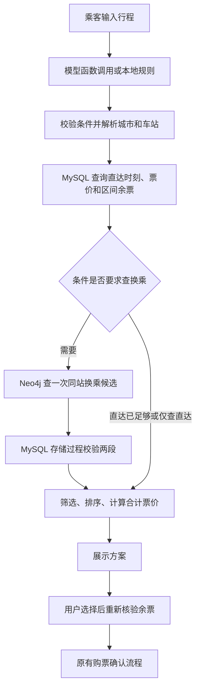
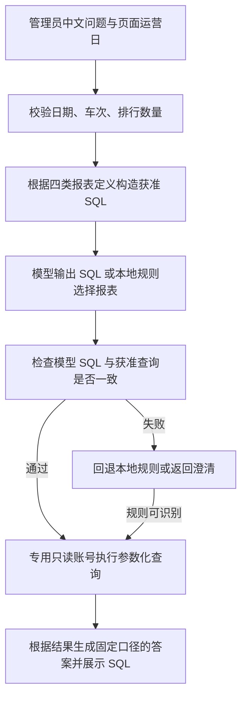

# 铁路客票系统 AI 功能说明

本文对应仓库中已实现的乘客行程助手、管理端运营问答和异常检测，适合项目交接、课堂演示和功能验收。

## 功能与入口

| 功能 | 页面入口 | 自然语言输入的用途 | 数据来源 |
|---|---|---|---|
| 乘客行程助手 | 乘客首页「我该怎么买？」 | 提取起终点、人数、席别、到达时限和换乘要求，规划可购买的行程 | MySQL 班次、票价、区间库存，Neo4j 停靠关系 |
| 管理端运营问答 | 管理台左侧「运营问答」 | 在四类报表范围内生成查询 SQL，并展示统计依据 | MySQL 运营只读视图 |
| 管理端异常检测 | 管理台左侧「异常检测」 | 根据确定性规则的检测证据生成解释和人工排查建议 | 库存一致性视图、全库订票缓冲连续采样 |

乘客端默认地址为 `http://127.0.0.1:8080/`，管理端入口为 `http://127.0.0.1:8080/admin-login.html`。初始管理员账号为 `admin`，默认密码为 `RailFlow@123`，实际值以部署配置为准。

两个功能共用模型接口配置。未设置 API Key 时，可以使用页面标明的本地规则模式。配置模型后，模型负责理解问题或输出 SQL，业务查询由 Python 后端执行，票价、库存和运营数字均取自数据库。

## 启动与模型配置

在仓库根目录使用运行服务的 Python 环境安装依赖，然后启动 Docker Desktop 和项目。

```powershell
python -m pip install -r app/requirements.txt
.\start.ps1
```

从旧版升级时也应安装依赖。`PyMySQL[rsa]` 支持 MySQL 8 新账号的首次认证，Neo4j 驱动用于换乘路径查询。

如需启用外部模型，在启动后端的同一 PowerShell 7 窗口中设置配置。

```powershell
$env:CR12306_AI_API_KEY = Read-Host '输入模型 API Key' -MaskInput
$env:CR12306_AI_BASE_URL = 'https://api.openai.com/v1'
$env:CR12306_AI_MODEL = 'gpt-4o-mini'
.\start.ps1
```

| 环境变量 | 含义 | 默认值 |
|---|---|---|
| `CR12306_AI_API_KEY` | 模型服务密钥，设置后启用模型调用 | 空，使用本地规则 |
| `CR12306_AI_BASE_URL` | 兼容接口的基础地址，后端追加 `/chat/completions` | `https://api.openai.com/v1` |
| `CR12306_AI_MODEL` | 服务提供的模型名称 | `gpt-4o-mini` |
| `CR12306_AI_TIMEOUT` | 模型请求超时秒数，取值限制为1至120 | `45` |

接口需要支持 Chat Completions 的 `tools` 和指定函数名的 `tool_choice`。单次模型请求默认超时为45秒，可用上述变量调整。百炼兼容接口会显式传递 `enable_thinking=false`，用于缩短结构化工具调用的响应时间。页面通过本项目后端使用模型。

阿里云百炼已在2026年11月18日使用 `deepseek-v4.1-flash-1017` 完成真实联调。使用已有系统级密钥时，可在启动窗口读取并配置。

```powershell
$env:CR12306_AI_API_KEY = [Environment]::GetEnvironmentVariable('DASHSCOPE_API_KEY', 'Machine')
$env:CR12306_AI_BASE_URL = 'https://dashscope.aliyuncs.com/compatible-mode/v1'
$env:CR12306_AI_MODEL = 'deepseek-v4.1-flash-1017'
.\start.ps1
```

本机本次配置已保存为用户级的 `CR12306_AI_API_KEY`、`CR12306_AI_BASE_URL`、`CR12306_AI_MODEL` 环境变量，并重启服务使其生效。密钥从现有系统变量读取，仓库和测试日志只记录非敏感配置。已打开的终端若仍持有旧环境，可按上面的命令显式读取。

如果服务已在运行，应先结束原服务，再从配置窗口启动。`start.ps1` 检测到已运行的服务时会复用它，新设置的环境变量需要新进程才能生效。页面结果中的模式文字可以用于核对是否已启用模型。

## 乘客端购票与行程规划

### 操作流程

1. 在乘客端输入姓名进入首页。
2. 在「我该怎么买？」输入行程需求，或点击示例后提交。
3. 阅读方案中的班次、上下车站、到发时间、席别、分段余票和合计票价。
4. 点击「确认本人车票」或「确认第几段本人车票」，进入原有购票确认页。
5. 核对本人、席别和座位偏好，再提交订单。

可直接试用下面的问题。

> 两个人从南通西到上海虹桥，下午3点前到，优先直达，可以换乘1次。

当前演示运行日固定为 **2026 年 10 月 14 日**，支持每次查询 1 至 5 人。省略日期和人数时，默认使用演示日和 1 人。起终点支持城市或具体车站，例如“上海”覆盖该城市车站，“上海站”指具体车站。

### 换乘与排序

| 输入条件 | 执行方式 |
|---|---|
| 不换乘，或未提出换乘需求 | 查询直达 |
| 可以换乘1次、最多换乘一次 | 查询直达及一次同站换乘，两类各展示至多三条路线 |
| 没票再换乘 | 没有满足本次人数、席别和时间条件的直达方案时，查询一次换乘 |
| 最便宜、优先省钱 | 在每类方案内按票价优先排序 |
| 未提出价格优先 | 在每类方案内按到达时间优先排序 |

直达方案展示在换乘方案之前。同一条路线优先保留排序最靠前的席别组合。换乘等待窗口为 15 至 240 分钟，两段都需要满足人数和席别要求。最晚到达时间对应同一乘车日，跨日到达的方案会受该条件过滤。

### 智能体与数据库如何协作



启用模型时，后端提供 `plan_trip` 工具的参数定义和提取规则。模型返回结构化条件，主要字段如下。

```json
{
  "origin": "南通西",
  "destination": "上海虹桥",
  "date": "2026-10-14",
  "people": 2,
  "arrive_by": "15:00",
  "seat": "",
  "transfer": "allowed",
  "sort": "arrival",
  "clarify": ""
}
```

`transfer` 可取 `direct`、`allowed`、`fallback`，分别表示仅直达、允许一次换乘、没有合适直达时换乘。后端验证字段类型、日期、人数和时间，再调用已有查询。模型提出澄清时，页面显示需要补充的信息。

MySQL 将班次、停靠时刻、票价、席别和座位关联。区间可用座位通过占用位图计算，当座位的 `occupied_mask` 与本次乘车区间掩码按位与等于 0 时，表示全区间空闲。对这些座位计数后检查是否满足同行人数。

Neo4j 的 `TrainRun`、`Station`、`CALLS_AT` 表达班次和停靠站的联系，停靠关系保存站序与到发时间。图查询生成最多 80 个候选，MySQL 的 `sp_validate_transfer_candidates` 再校验班次、区间、换乘窗口、票价和余票。因此当前结果基于有限候选集，候选截断可能影响可见路线范围。

### 购票边界与异常处理

| 情况 | 当前行为 |
|---|---|
| 模型接口失败或返回无效参数 | 回退本地规则，结果标明当前模式 |
| 本地规则无法理解完整问题 | 提示改写问题，不执行部分识别出的行程 |
| 请求其他日期、超过5人或超过一次换乘 | 提示修改到支持的范围 |
| 请求预算上限、指定出发时刻等尚未支持的条件 | 提示澄清或改写 |
| 未找到满足条件的路线 | 说明当前直达或换乘候选未满足要求 |
| 查询数据库失败 | 页面显示查询失败，可在数据库恢复后重新查询 |
| 选择方案时余票已变化 | 重新核验后提示再次规划 |

多人规划会按人数核验每段余票并显示合计金额，实际购票页每次确认本人的一段车票。同行人分别办理，换乘的两段分别确认。方案查询和进入确认页均不预占库存，最终占座沿用原有订单存储过程及并发校验。

## 管理端运营问答

### 操作流程与统计范围

管理员登录后进入「运营问答」，选择运营日并输入问题。页面展示自然语言答案、查询模式、统计范围、统计时间、口径、结果表，以及可展开的 SQL 和绑定参数。

当前每次查询一个运营日，可指定一个车次，省略车次时统计全部车次。问题中明确写出的 `YYYY-MM-DD` 日期优先于页面日期。运营日对应班次发车日期，订单使用查询时的当前状态，包含演示压测产生的订单。

| 支持的问题 | 示例 | 统计口径 |
|---|---|---|
| 候补区间排行及二等座余票 | G8359 哪个区间候补人数最多？这个区间的二等座还剩多少？ | 同一班次、相同上下车站，累计 `WAITING`、`MATCHING` 请求的 `passenger_count`，覆盖所有席别。另行统计该区间在售二等座的全程空闲座位 |
| 订单状态分布 | 订单状态分布 | 按当前状态分组，对 `order_id` 去重，一笔多人订单算一笔 |
| 已支付订单数 | G8359 已支付订单有多少笔？ | 对当前状态为 `PAID` 的订单号去重，已退款订单排除 |
| 缓冲请求状态分布 | 缓冲请求状态分布 | 每条持久化请求计一次，重试次数不重复计数 |

候补排行支持“前5名”等输入，范围为前 1 至 20 项。“哪个区间”默认取第一项，其余排行默认取前 10 项。候补人数相同按车次、上下车站排序。二等座余票为 0 表示在售产品已无空座，空值表示没有在售二等座产品。

### NL2SQL 执行流程



模型调用使用 `query_operations` 工具，返回包含 `sql` 和 `clarify` 的对象。Prompt 提供报表说明和获准 SQL，要求保留占位符、列、分组、排序和结果条数。日期、车次由后端提取并绑定。

当前实现采用严格的 SQL 模板匹配。校验会规范化空白和大小写，允许移除末尾单个分号，再与后端生成的候选 SQL 比较。如果本地规则已识别问题，还要求模型选择同一指标。仅语义相似但写法不同的 SQL 也可能触发回退，因此模型的查询能力限定在这四类报表内。

例如“G8359 已支付订单有多少笔？”对应下面的 SQL。

```sql
SELECT COUNT(DISTINCT order_id) AS paid_orders FROM v_ops_orders
WHERE service_date = %s AND train_no = %s
AND order_status = 'PAID'
LIMIT 20
```

绑定参数为 `["2026-10-14", "G8359"]`。最终执行的是校验后选中的后端查询模板。答案由查询结果按固定规则生成，模型调用阶段仅发送本次问题与报表定义，数据库返回行不参与第二次模型总结。

### 报表视图与读取权限

V020 迁移创建以下视图和 `railflow_ops_reports` 只读角色。

| 视图 | 用途 |
|---|---|
| `v_ops_wait_segments` | 先按班次和上下车区间汇总候补人数，再用独立子查询计算二等座余票，避免候补行与座位行相乘 |
| `v_ops_orders` | 提供运营日、车次、订单号和当前状态，查询时按订单号去重 |
| `v_ops_buffer` | 按运营日、车次、缓冲状态预聚合请求数量 |

`start.ps1` 会执行幂等的 V020 安装，为当前服务端口建立 `railflow_ops_<端口>` 账号，生成进程使用的密码并授予只读角色。也可以提供 `CR12306_OPS_DB_USER`、`CR12306_OPS_DB_PASSWORD` 使用预配置账号，两项应同时设置。

报表查询走独立 PyMySQL 连接和只读事务，V020 授予角色三个报表视图的 SELECT 权限，V021 追加库存一致性视图的读取权限。单条 SELECT 的数据库执行时间限制为 4000 毫秒，连接超时 4 秒、读取超时 7 秒，运营问答报表最多返回 20 行。整体请求时间还包括模型调用和连接时间。

### 失败与澄清

| 情况 | 当前行为 |
|---|---|
| 管理员未登录或会话过期 | 接口返回 401，页面转到管理登录 |
| 相对日期、多日期、多车次、非法日期或排行范围过大 | 返回澄清提示 |
| 模型 API 超时、返回结构无效 | 尝试本地规则，并标明模型接口暂不可用 |
| 模型 SQL 未通过模板校验 | 尝试本地规则，并标明模型 SQL 未通过校验 |
| 本地规则也无法识别 | 提示支持的指标，请管理员明确问题 |
| 模型明确返回澄清 | 页面展示模型的澄清文本 |
| 数据库连接、权限、视图或执行时间异常 | 接口返回查询失败提示，请检查运行环境或缩小范围后重新查询 |
| 有效聚合得到0 | 返回0笔，候补无记录时说明队列范围内没有等待或匹配请求 |

当前数据库执行报错会直接反馈到页面，未实现把数据库错误交给模型自动改写 SQL 并重试的循环。可支持的扩展需同时补充指标定义、只读视图或查询模板、界面说明和验证。

## 异常检测与 AI 解释

管理台「异常检测」提供「检测当前数据」「检测并解释」「用模拟样本验证规则」三个入口。库存默认检查运营日 2026-10-14 的 G8359，支持选择日期和输入完整车次。缓冲检测覆盖全库请求，页面显示本次快照，点击检测或顶部刷新可取得新快照。

### 库存一致性

V021 的 `v_anomaly_seats` 在同一 SELECT 的只读快照中，将每个现有运行座位的 `HOLD`、`CONFIRMED` 分配区间掩码按位或合并，再与 `train_run_seat.occupied_mask` 比较。分配状态作为有效性的依据，已释放记录排除。

检测包含两项规则。两份位图不一致时列出发生差异的区段序号，序号1对应第1站至第2站。若有效分配的区段数总和大于合并位图的置位数，则存在重叠分配，即使库存位图恰好等于合并位图也会告警。一个座位出现多项问题只计一个异常座位。

页面给出检查座位数、异常座位总数、运行ID、座位ID、车厢、座位号、库存位图、分配合并位图和重叠标记。位图按十进制字符串返回，避免浏览器丢失64位整数精度。最多展示50个异常座位。没有运行座位时显示无可检查数据。本规则范围为现有运行座位，其他数据约束仍由原数据库约束和订单逻辑负责。

### 持续积压

后端启动一个采样线程，每5秒读取全库订票缓冲表，记录排队数、处理中数量、最老排队请求等待秒数、过期处理租约数和发生重试的待处理请求数。最近13次样本保存在当前服务进程内存中。

最近3次连续有效采样覆盖至少10秒，且排队数和最老等待时间均逐次严格增加、最后最老等待时间至少10秒时触发告警。该规则检验队列持续增长。排队人数稳定、队列下降或只有一次流量突增时不会触发此项规则。过期租约和重试数量作为排查证据展示。

不足3次采样时显示采样中。采样失败或超过15秒未更新时显示暂不可用，恢复后重新积累连续窗口。服务重启会清空历史。查询失败不会被展示为健康结果，页面无需一直打开也能在后台持续采样。

### 模型与程序的职责

「检测并解释」先重新读取真实证据并运行确定性规则，再调用共用模型接口的 `explain_anomalies` 工具。发送内容包括查询范围、库存汇总、缓冲采样和规则定义。模型返回简短解释与人工核查方向，页面把模型建议展示在规则结果之后。Prompt 要求推测标明待验证，检测状态仍由程序计算。

未配置 Key 时使用本地解释，接口失败时回退本地解释并显示模式。当前使用规则检测加模型辅助诊断，无自动修复流程，根因需结合订单事件、库存事件和工作线程日志核查。

### 可重复验证

点击「用模拟样本验证规则」即可读取独立样本，页面醒目标明为模拟证据。01A 的库存位图为3、分配合并位图为1，会报告第2个区段不一致。01B 的两份位图均为7，但有效分配累计4段、合并后仅3段，会报告重叠分配。缓冲样本的时间为0、5、10秒，排队数为2、4、7，最老等待为10、15、20秒，会触发持续积压。

模拟数据通过与真实数据相同的规则函数判定，读取模拟样本不会修改业务表或缓冲采样历史。点击「检测当前数据」可回到真实检测。正常、异常、短窗口、采样中断、模型失败和恢复路径由 `app/tests/test_anomalies.py` 覆盖。

接口为管理员专用的 `POST /api/admin/anomalies/check`，请求体例如 `{"date":"2026-10-14","train":"G8359","explain":true}`。模拟验证使用 `GET /api/admin/anomalies/demo`。均沿用管理端会话认证。

## 课堂演示与验收

1. 使用本地规则模式启动，演示乘客输入“两个人从南通西到上海虹桥，下午3点前到，优先直达，可以换乘1次”，检查结果摘要中的人数、到达时间和换乘条件。
2. 分别尝试“不换乘”和“没票再换乘”，观察查询范围及方案变化。若要展示余票不足，可使用现有演示库存或订票压测制造真实的座位变化。
3. 选择方案进入确认页，核对上下车站、席别和票价，说明最终占座仍由订单事务处理。
4. 登录管理端，查询同一运营日的订单状态、G8359 已支付订单和缓冲状态，展开 SQL 和绑定参数。
5. 查询候补最多的区间，说明人数与请求条数的区别。队列为空时展示空结果，演示有候补的情形需先通过现有购票流程产生候补。
6. 输入“今天的订单状态分布”或不支持的指标，检查澄清提示。
7. 如已配置真实模型，重启后重复操作并核对模式文字。API Key 无效时检查回退提示。

现有自动检查可在仓库根目录执行。

```powershell
python -m unittest discover -s app/tests
node --check app/web/admin.js
node --check app/web/admin-operations.js
node --check app/web/travel-assistant.js
.\app\tests\test_startup_compatibility.ps1
```

本次实现已通过27项 Python 单元测试，覆盖行程约束、换乘、模型函数调用、模型失败回退、运营口径、非法 SQL 回退、库存异常及采样窗口和恢复路径，并通过启动兼容检查。管理端已使用本机真实数据库验证登录限制、四类报表、SQL 与参数展示，订单和缓冲统计与原表独立聚合一致。

### 2026年11月18日百炼 DeepSeek 真实联调

用户选择百炼及 `deepseek-v4.1-flash-1017`，并明确授权发送库存检查汇总和缓冲采样进行解释测试。测试期间模型接收的问题、工具定义及汇总证据均按各功能的实现范围发送。

| 验证项目 | 结果 |
|---|---|
| 模型最小函数调用 | 成功调用指定工具并返回结构化参数 |
| 乘客直达、允许一次换乘、条件换乘 | 均返回“模型 API”，符合条件的直达最多3条、一次换乘最多3条 |
| 城市范围、二等座、价格优先 | 余票满足人数，席别与合计金额正确，每类方案按价格排序 |
| 日期超出范围、超过5人、未支持预算 | 返回澄清或支持范围提示 |
| 四类运营报表 | 均返回“模型 NL2SQL”，订单及缓冲结果与原始表独立聚合核对一致 |
| “今天”类运营问题 | 在范围解析阶段提示明确运营日 |
| 真实库存与缓冲模型解释 | G8359核对218个座位，异常数0；缓冲未触发规则，页面成功显示模型解释 |
| 模拟异常模型解释 | 正确区分1个位图差异座位、1个重叠分配座位，以及满足规则的积压样本 |
| 乘客浏览器购票闭环 | 模型规划、余票复核、提交、演示支付、显示电子票、订单退票均通过，区间余票180→179→180 |
| 管理端浏览器流程 | 真实模型查询、结果表、SQL展开及模型异常解释通过，无页面脚本错误 |

接口验收共13项通过，主要请求约1至5秒完成。模型接口故障和 SQL 校验失败回退通过自动化模拟测试验证。浏览器测试共保留两笔已退票的独立测试订单和对应测试乘客，当前无测试占座。

联调初期发现15秒请求时限会导致部分模型响应回退，现已调整默认时限并对百炼关闭思考模式。运营 Prompt 已加入页面确定的运营日，避免模型重复追问日期。异常解释增加位图差异与重叠分配两个独立计数，并说明演示运营日与当前全库缓冲采样时间互相独立。

## 对应实现

| 文件 | 作用 |
|---|---|
| `app/model_api.py` | 共用模型函数调用 |
| `app/travel_assistant.py` | 乘客条件提取、校验、规划和结果组织 |
| `app/ops_qa.py` | 运营指标、范围解析、SQL 校验与答案生成 |
| `app/anomalies.py` | 库存规则、连续采样、模拟验证和模型解释 |
| `app/web/admin-anomalies.js` | 异常状态、证据表和解释展示 |
| `app/server.py` | HTTP 路由、MySQL 直达查询、Neo4j 候选和存储过程调用 |
| `app/db.py` | 业务数据库连接与独立报表读取 |
| `app/web/travel-assistant.js` | 乘客助手展示、余票复核及购票衔接 |
| `app/web/admin-operations.js` | 运营问答表单、结果表与 SQL 展示 |
| `database/migrations/V020__operations_reporting.sql` | 报表视图与只读角色 |
| `database/migrations/V021__anomaly_evidence.sql` | 库存一致性证据视图与授权 |
| `start.ps1` | 报表安装、只读账号准备与服务启动 |
