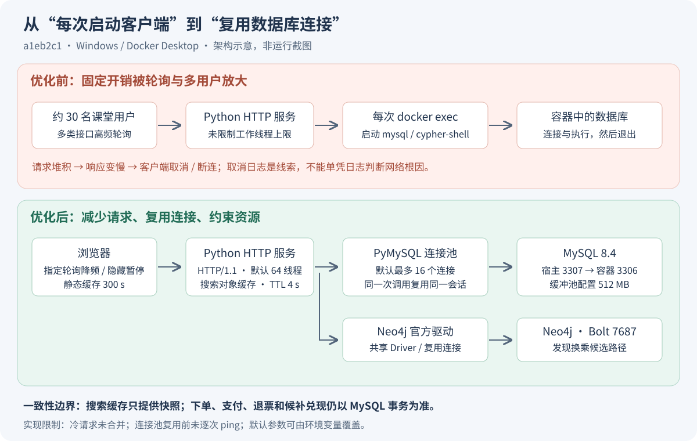
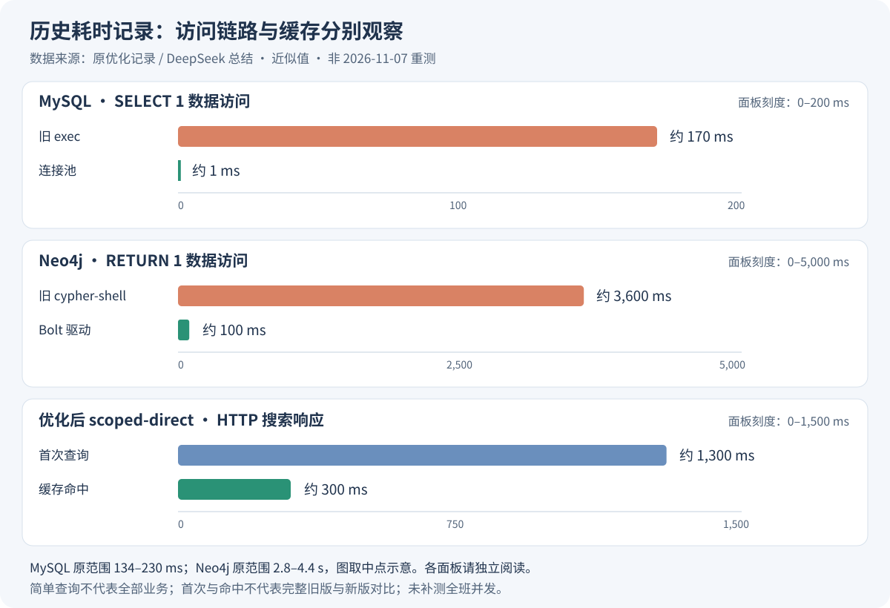

# 14 课堂并发测试后的性能优化全过程

> 用途：供队友撰写优化报告、制作汇报页及复现实验。整理日期：2026-11-07。
>
> 优化实现：[`a1eb2c1`](https://github.com/Yihan-Cheng/12306/commit/a1eb2c1c18cfc4a60e97fd62a06b5c53c153d3a0)（2026-10-14）；对比基线：`c2d4ab8`。本文在原优化记录上补充全过程与证据边界。

## 1. 核心结论与证据范围

课堂约 30 余人同时访问时，出现页面难以进入、订票反馈慢、管理端 AI 批量退票等待较久的问题。历史排查记录显示，主要瓶颈是应用每次访问数据库都启动 `docker exec` 和数据库命令行客户端，进程启动及通信开销被多用户高频轮询放大。优化首先将数据访问改为持久连接，再通过搜索缓存、轮询降频、有界线程、HTTP 连接复用与数据库缓冲池配置减少重复工作。

历史记录中，MySQL 简单查询访问耗时从 134–230 ms 降到约 1 ms；Neo4j 简单查询从 2.8–4.4 s 降到约 0.1 s。**这些不能写成所有业务接口都达到 1 ms，也不能据此宣称优化后的全班并发已通过验收。**

本文区分四种证据：

- **历史实测**：原版优化文档及 DeepSeek 总结；未附完整逐次采样、压测日志和百分位统计。
- **代码复核**：本次对照 `a1eb2c1` 与父提交检查实现，可确认改动及默认配置。
- **本次验证**：2026-11-07 实际运行的语法检查及既有离线测试，见第 8 节。
- **待补实验**：优化后 30 人并发、批量退票端到端耗时、512 MB 缓冲池的独立收益。

## 2. 课堂测试场景与故障表现

系统运行于 Windows + Docker Desktop，由 Python 提供 Web 服务，通过 Cloudflare Quick Tunnel 向同学开放。MySQL 保存订单、支付、候补和位图库存；Neo4j 提供换乘候选；Redis 是此前已有的可选唤醒加速层。

历史记录中的现象：

1. 30 余人同时进入，开场数分钟页面极慢，部分用户难以进入。
2. 一段时间后逐渐恢复，历史描述为用户最终能够订票；没有可量化的成功率统计。
3. 管理端 AI 批量退票等待较久。
4. cloudflared 和 Python 出现 `canceled by remote`、`ConnectionAbortedError` 等日志。

[手动 Runbook](../课堂演示手动Runbook.md) 的“70 人抢 10 张票”是演示设计，不能替代此次约 30 人访问的实际测试规模。现存记录也未明确课堂测试的起止时刻，不能把提交时间直接当成测试时间。

## 3. 排查过程：从断连日志追到访问链路

### 3.1 将网络表象与服务端耗时分开

断连说明请求尚未完成时客户端或代理关闭了连接。结合页面迟缓，历史排查将其主要解释为慢响应引发的后果。仅凭取消日志不能排除所有公网网络因素，但应先处理能够本机复现的固定开销。

### 3.2 用最小查询隔离客户端启动开销

原 `mysql_rows()` 每次执行 `docker exec mysql84 mysql ...`，原 `neo4j_rows()` 每次执行 `docker exec neo4j-12306 cypher-shell ...`。即使只有 `SELECT 1` 或 `RETURN 1`，也要启动外部进程和数据库客户端并建立连接。

历史环境为 MySQL 8.4 容器 `mysql84`，记录如下：

- `docker exec` 执行 MySQL `SELECT 1`：134–230 ms；持久连接执行同类查询：约 1 ms。
- `docker exec` 执行 Neo4j `RETURN 1`：2.8–4.4 s；Bolt 驱动同类查询：约 0.1 s。
- 数据库内部执行 `SELECT * FROM v_order_detail WHERE user_id=25`：约 0.1 ms。
- 城市对 `scoped-direct` 纯数据库查询：约 640 ms，涉及约 44 万行 `train_run_seat` 的关联聚合。

前一类主要反映访问链路成本，后一类还存在真实 SQL 聚合成本，需要分开优化。

### 3.3 结合数据库状态定位资源瓶颈

当时 `Threads_running` 较低，`Max_used_connections=6`，`max_connections=151`。这支持没有首先耗尽 MySQL 连接数的判断，应优先减少外部调用，而非盲目调高连接上限。没有保存完整 CPU profiling 与进程时间线，因此“CPU 全耗在进程创建”“Docker 完全串行化”只能作为当时的诊断解释，不宜写成已有采样严格证明的结论。

### 3.4 解释多用户轮询与退票的放大效应

```text
每秒数据库调用量 ≈ 活跃用户数 × 每人每秒请求数 × 每请求数据库调用数
旧方式的进程调用量 ≈ 数据库调用量
批量退票访问开销 ≈ 订单数 × 每单调用数 × 单次固定访问成本
```

例如，仅一个每 2 s 刷新的接口，30 名用户就约有 15 次 HTTP 请求/s；若每请求调用数据库 5 次，就约有 75 次外部调用/s。其他页面与后台任务还会叠加。这是计算示例，不是实测 QPS。

按历史估算，退 100 单若每单调用 4–6 次数据库，就约有 400–600 次外部调用；用约 170 ms 固定访问成本估算，仅这部分约 68–102 s。此计算解释机制，**不是批量退票实测耗时**。

## 4. 优化前后架构



图 1：改变应用访问数据库的方式，并减少重复工作。数据库仍在 Docker 中运行；订单与库存的最终判断仍由 MySQL 事务及存储过程完成。图为根据源码绘制的示意，不是现场截图。

默认池模式连接 `127.0.0.1:3307`，Compose 将宿主机 `3307` 转发到 MySQL 容器 `3306`；Neo4j 使用 `bolt://127.0.0.1:7687`。因此由旧 `exec` 方式切换后，宿主机发布端口必须可达。

## 5. 实施过程与改动说明

以下按问题及依赖关系整理，不代表各项都有独立时间戳或单独提交。

### 5.1 P0：数据库驱动与持久连接池

新增 [`app/db.py`](../../app/db.py)，`server.py` 导入 `DatabaseError`、`mysql_rows` 和 `neo4j_rows`。MySQL 使用 PyMySQL、`LifoQueue` 与线程锁，默认连接上限 16，按需创建并复用。单次调用独占所借连接，用完归还；池耗尽最多等待 15 s，超时返回 503。配置 `utf8mb4`、`DictCursor`、`autocommit=True`，连接超时 5 s，读写超时各 120 s。

为兼容既有业务调用，处理了以下细节：

- 保持 `mysql_rows(sql, timeout)` 与 `neo4j_rows(cypher, timeout)` 的调用签名。
- 使用 `CLIENT.MULTI_STATEMENTS`，一次借用内执行 `CALL ...; SELECT @var;`，保证输出变量与存储过程处于同一会话。
- 通过 `nextset()` 遍历多个结果集，保留既有读取末条输出行的用法。
- 对日期、`Decimal`、字节串归一化，兼容 JSON 与既有消费逻辑；数值并非全部转换成字符串，不应称作类型逐字节相同。
- 对操作或接口级 MySQL 异常丢弃连接，避免把已知失效连接放回池中；数据库错误转换成 `DatabaseError`。

Neo4j 改用官方驱动，惰性创建共享 Driver，每次调用创建会话，复用驱动管理的连接。`app/requirements.txt` 已包含 `PyMySQL==1.1.2` 与 `neo4j==5.28.2`，本提交没有新增依赖文件，但启动环境须安装它们。

**实现边界：** `ping(reconnect=False)` 只在新连接创建时发生，复用连接借出前没有逐次健康检查；池模式也没有把调用传入的 `timeout` 映射成查询超时。保留签名不等于所有超时语义完全相同。

### 5.2 P1：短 TTL 搜索缓存

`cached_search()` 覆盖 `/api/search/direct`、`/api/search/scoped-direct` 和 `/api/search/transfer`。以完整请求路径（含参数）为键，默认 TTL 为 4 s；命中直接返回已计算对象，`CR12306_SEARCH_CACHE_TTL=0` 可关闭。

需要准确描述边界：字典读写受锁保护，但 `builder()` 在锁外运行，**同键的多个冷请求仍可能同时查询，没有进行中的请求合并**。TTL 从查询开始前计时，慢查询会消耗有效窗口；URL 参数顺序不同也会产生不同键。超过 256 项时只清理过期项，256 不是严格容量上限。缓存保存 Python 对象，每次响应仍要 JSON 序列化。

搜索余票是短时快照，下单仍由 MySQL 锁座逻辑最终复核。Redis 及 MySQL 请求缓冲区是已有机制，不能写成本轮新增的搜索缓存；本轮缓存位于 Python 进程内。

### 5.3 P1：轮询降频与隐藏页面暂停

[`app/web/app.js`](../../app/web/app.js) 的搜索结果从 2 s 改为 4 s，订单从 1.5 s 改为 3 s，候补通知从 5 s 改为 8 s；[`app/web/admin.js`](../../app/web/admin.js) 中总览、候补与缓冲区当前视图刷新从 2 s 改为 4 s。这些定时器增加 `document.hidden` 判断，用户端回到前台时会补拉数据。

只按定时器周期计算，前三类频率分别降低 50%、50%、37.5%，管理端对应刷新降低 50%；不是全站请求总量的实测降幅。管理端 AI 活动任务仍保留 900 ms 轮询，未增加隐藏判断，不能写成“全部轮询均降频并暂停”。

### 5.4 P2：有界线程、HTTP 复用与静态缓存

- `Handler.protocol_version = "HTTP/1.1"`，启用持久连接，空闲超时为 30 s。
- `BoundedThreadingHTTPServer` 用信号量限制 HTTP 工作线程，默认 64，监听队列配置 128。
- CSS、JS、图片与字体设置 `Cache-Control: public, max-age=300`；HTML 使用 `no-cache`，JSON 使用 `no-store`。
- 对响应写出时的 `BrokenPipeError`、`ConnectionResetError`、`ConnectionAbortedError` 做静默处理，减少客户端取消导致的 traceback。

线程上限约束资源消耗，不会提高 SQL 本身速度，也不是无限排队保证；HTTP 长连接仍可能占用工作线程。64 个 HTTP 线程、16 个 MySQL 连接与订票后台工作者是不同资源，不能称为“64 个订票事务并发”。断连静默也不会自动取消已经执行的数据库操作。

### 5.5 P2：管理端热门车次聚合查询重写

同一提交还修改了 `/api/admin/overview`：原热门车次查询通过两段相关子查询从 `v_train_run_stop` 取首末站；新实现先按 `run_id` 聚合 `train_run_seat`，再关联车次、首末站序号和站点。

目标是减少相关子查询与时刻视图重复展开。没有保存此项单独的 `EXPLAIN ANALYZE` 或耗时采样，因此不能把 overview 的全部收益都归因于这次 SQL 重写。

### 5.6 P3：InnoDB 缓冲池配置

[`docker-compose.yml`](../../docker-compose.yml) 增加：

```yaml
command: ["--innodb-buffer-pool-size=512M"]
```

历史记录以默认 128 MB 与约 44 万行热点为调整依据，提高到 512 MB，目标是减少物理读。是否装得下实际工作集，应看表、索引大小与命中数据；行数本身不足以证明容量。本轮没有隔离测量缓冲池调整的收益。

### 5.7 同提交配套工作及前置优化

`a1eb2c1` 共涉及 18 个文件，还包括以下可运行性改进：

- `start.ps1` 用原始 UTF-8 字节输入迁移 SQL，同时读取输出和错误流，降低中文损坏及管道等待风险。
- 从版本脚本提取最终 routine 定义，只修复缺失函数和存储过程；区分迁移前核心依赖与迁移后修复，避免重放表结构和业务数据操作。
- 新增 `app/tests/test_startup_compatibility.ps1`，覆盖空、完整及部分 routine 目录、最终定义选择与 SQL 失败传播。
- V019 将演示运营日改为 `2026-10-14`，同步默认查询日期、页面及演示文档；按日期差移动候补截止时间，保留库存。

日期调整属于演示配置，不是性能优化。V017 行程冲突检查与 V018 订单详情视图优化早在 `cb8dad1` 已入库，是本轮前置基础：V017 从指定乘车人的订单明细出发校验冲突，V018 从订单及明细出发关联时刻，以减少先展开全量时刻视图的工作；不能把它们归为 `a1eb2c1` 新增。

## 6. 历史性能结果及正确解读



图 2：各面板使用独立线性刻度。前两项比较简单数据库查询的访问耗时；第三项比较优化后同一搜索接口的首次请求与缓存命中。数值为历史近似值，不是本次重测。

- MySQL `SELECT 1`：134–230 ms → 约 1 ms，约 134–230 倍；图中取历史代表值 170 ms。
- Neo4j `RETURN 1`：2.8–4.4 s → 约 0.1 s，约 28–44 倍；图中 3.6 s 为原区间中点示意。
- `/api/waits`、`/api/orders`：约 170 ms → 客户端观察 27–30 ms；另记服务端约 1–3 ms。测量边界不同，不能写成 HTTP 响应 1 ms。
- `/api/admin/overview`：约 1 s → 数十毫秒，涉及多条 SQL；未保留逐次样本和分位数。
- `scoped-direct`：首次约 1.3 s，缓存命中约 0.3 s，约快 4.3 倍。**不是完整旧版与新版无缓存对比。**
- 连续 200 条常连接查询总计约 177 ms，平均约 0.885 ms/条；串行平均耗时不能直接换算成系统并发吞吐。

历史记录还提到搜索响应约 400 KB，序列化和客户端开销会影响响应时间，但没有详细分段计时，不宜给各项开销指定精确占比。复杂换乘业务另记约 2.8 s，应与简单 `RETURN 1` 的访问成本分开。

## 7. 使优化生效：交给队友的操作步骤

本次仅整理文档，没有重启或迁移数据库，没有清理或改写业务数据。

### 7.1 更新代码与依赖

在项目根目录执行；如有未提交工作，应先保存再更新：

```powershell
git pull --ff-only origin main
python -m pip install -r app/requirements.txt
```

### 7.2 应用容器配置并重启 Web

打开 Docker Desktop，在可以接受 MySQL 短暂不可用时执行：

```powershell
docker compose up -d mysql
docker compose ps
docker exec mysql84 mysql -uroot -p -D CR12306 -e "SHOW VARIABLES LIKE 'innodb_buffer_pool_size';"
```

末条交互输入数据库密码，目标值为 `536870912`（512 MiB）。`compose up` 按配置更新或启动容器，已有 `mysql-data` 卷保留数据，不需要删除卷或清库。`start.ps1` 对已有容器主要调用 `docker start`，不能保证应用新容器命令，故需保留显式 `compose up` 步骤。

确认 MySQL、Neo4j 就绪后，在旧 Web 服务窗口按 `Ctrl+C`，再在同一终端执行：

```powershell
$env:CR12306_DB_BACKEND = 'pool'
python app/server.py
```

`start.ps1` 发现 8080 已有健康服务会直接返回，不会替换旧进程；只修改文件或重跑启动脚本不能证明新代码已加载。JS 最长缓存 300 s，演示前应强制刷新浏览器。

### 7.3 默认配置与日期注意事项

启动时读取的主要配置：`CR12306_MYSQL_HOST=127.0.0.1`、`CR12306_MYSQL_PORT=3307`、`CR12306_DB=CR12306`、`CR12306_MYSQL_POOL_SIZE=16`（范围 2–64）、`CR12306_NEO4J_URI=bolt://127.0.0.1:7687`、`CR12306_MAX_THREADS=64`（范围 8–256）、`CR12306_SEARCH_CACHE_TTL=4`。凭据由对应 MySQL/Neo4j 用户名与密码环境变量提供。

V019 固定运营日为 `2026-10-14`，销售结束为 `2026-10-16 00:00:00`。本次整理日期已晚于该窗口，今天直接复演可能遇到业务日期校验，不能误判为连接池退化。新演示日期应走项目迁移流程，同步图数据、页面默认值与测试参数；不要原地修改已执行 V019 来伪造对比结果。

## 8. 验证记录与复测方案

### 8.1 优化当时记录的检查

历史总结记载 `/api/health`、`/api/locations`、`/api/waits`、`/api/orders`、`/api/availability`、`scoped-direct` 及静态资源正常返回 200；未登录 `/api/admin/overview` 返回 401；JS 语法和 Python 解析通过。

这些说明基本链路得到验证，不等于全部事务异常、断线恢复和课堂并发都已覆盖。overview 的 401 只证明未登录分支，不证明完整聚合查询的性能。

### 8.2 本次实际检查（2026-11-07）

- 对 `app/` 下 6 个 Python 文件进行 AST 解析：通过。
- `node --check app/web/app.js` 与 `node --check app/web/admin.js`：通过。
- `python -B -m unittest discover -s app/tests -p test_live_inventory.py`：6 项通过，覆盖区间复用、占座统计、候补状态与参数校验等离线快照语义。
- `app/tests/test_startup_compatibility.ps1`：通过，使用模拟函数验证修复流程，不连接数据库。
- `docker ps`：Docker Desktop Linux Engine 管道不存在；8080 未发现监听服务。因此本次未重测 HTTP 状态及延迟，也没有补造现场测试截图。

### 8.3 建议补测步骤

1. 固定硬件、版本、数据量、运营日和配置，记录提交号。完整基线用 `c2d4ab8`；`exec` 只回退访问后端，仍保留缓存与轮询改动，不能充当完整旧版。
2. 先测最小查询，再测实际接口；首查、预热、缓存命中分开采样，记录样本数、中位数、P95 与错误率，不只选最快一次。
3. 固定城市对、日期、人数及偏好参数，关闭 TTL 测真实 SQL，再恢复缓存测重复请求；额外测试同键冷请求同时到达。
4. 用相同操作序列复现 30 人访问，分开测本机直连与公网隧道，观察进程数、线程数、数据库连接和 CPU。
5. 在独立演示数据验证下单、支付、取消、退票、候补兑现与库存一致性。批量退票固定相同订单数量和状态，记录总耗时、成功及失败数，对比前恢复同等初始库存。
6. 单独比较 128 MB 与 512 MB 缓冲池，固定其他条件，记录冷热缓存、物理读与查询时间；完成前不宣称独立收益百分比。

以下只读示例可在环境就绪后检查连通性；首条包含可能的首次建连开销，不是业务压测：

```powershell
python -c "import sys,time; sys.path.insert(0,'app'); from db import mysql_rows,neo4j_rows; t=time.perf_counter(); print(mysql_rows('SELECT 1 AS ok')); print('MySQL ms:',(time.perf_counter()-t)*1000); t=time.perf_counter(); print(neo4j_rows('RETURN 1 AS ok')); print('Neo4j ms:',(time.perf_counter()-t)*1000)"
curl.exe --noproxy "*" -i --max-time 30 http://127.0.0.1:8080/api/health
curl.exe --noproxy "*" -i --max-time 30 http://127.0.0.1:8080/api/admin/overview
```

健康接口应正常响应；未携带管理员 Cookie 的 overview 应为 401。业务测试应使用当前有效用户、车次及运营日期，不能沿用旧 ID 后把不存在的数据当成故障。

## 9. 回退与后续工作

结束当前 Web 进程后，在同一终端执行：

```powershell
$env:CR12306_DB_BACKEND = 'exec'
python app/server.py
```

环境变量在模块导入时读取，运行中修改不生效。回退会恢复逐次进程开销，不会撤销缓存、轮询和缓冲池配置。模块顶层仍导入 PyMySQL 与 Neo4j，依赖缺失不能靠 `exec` 绕过安装。

后续工作应由实测驱动：

- 为仍约 640 ms 的城市对搜索保存执行计划，研究聚合扇出、覆盖索引与响应字段精简；本轮尚未完成。
- 增加同键冷请求合并、严格缓存容量及更明确的快照失效策略。
- 完善复用连接健康检查、断线恢复、会话状态清理与逐次超时，并验证存储过程异常路径。
- 单独分析复杂换乘查询；换 Bolt 驱动不等于复杂图计算变成 0.1 s。
- 补充优化后课堂规模并发与批量退票验收，验证线程上限和长连接的实际配合。

## 10. 队友写报告可直接参考的结构

建议按“课堂现象 → 分层测量 → 根因 → 分层改进 → 结果验证 → 局限与后续”组织。图 1 用于实现方案，图 2 用于结果页；引用数字时保留历史记录、约值和测量边界。

可改写的结论段：

> 针对课堂多人访问时的迟缓，我们比较数据库内部执行时间与应用访问耗时，发现逐次启动 Docker 命令行客户端带来的固定成本被多用户轮询放大。随后以 PyMySQL 连接池和 Neo4j Bolt 驱动复用连接，并配合短时搜索缓存、轮询降频、HTTP 持久连接及有界线程控制资源消耗。历史记录中，MySQL 简单查询访问耗时由 134–230 ms 降至约 1 ms，Neo4j 简单查询由 2.8–4.4 s 降至约 0.1 s。城市对搜索仍有聚合成本；优化后的全班并发效果与缓冲池独立收益仍需进一步验证。

### 源码与历史依据入口

- 核心：[数据库访问层](../../app/db.py)、[HTTP 服务与缓存](../../app/server.py)、[用户端](../../app/web/app.js)、[管理端](../../app/web/admin.js)、[容器配置](../../docker-compose.yml)。
- 配套：[启动脚本](../../start.ps1)、[启动测试](../../app/tests/test_startup_compatibility.ps1)、[V019](../../database/migrations/V019__move_demo_service_date_to_oct14.sql)。
- 前置：[V017](../../database/migrations/V017__fast_itinerary_conflict_guard.sql)、[V018](../../database/migrations/V018__fast_order_detail_view.sql)。
- 原文：`git show a1eb2c1:docs/design/14-query-latency-optimization.md`；差异：`git diff c2d4ab8 a1eb2c1 -- app docker-compose.yml start.ps1 database/migrations`。
- 演示：[手动 Runbook](../课堂演示手动Runbook.md)、[公网演示](../课堂公网演示.md)、[应用运行说明](../../app/README.md)。
