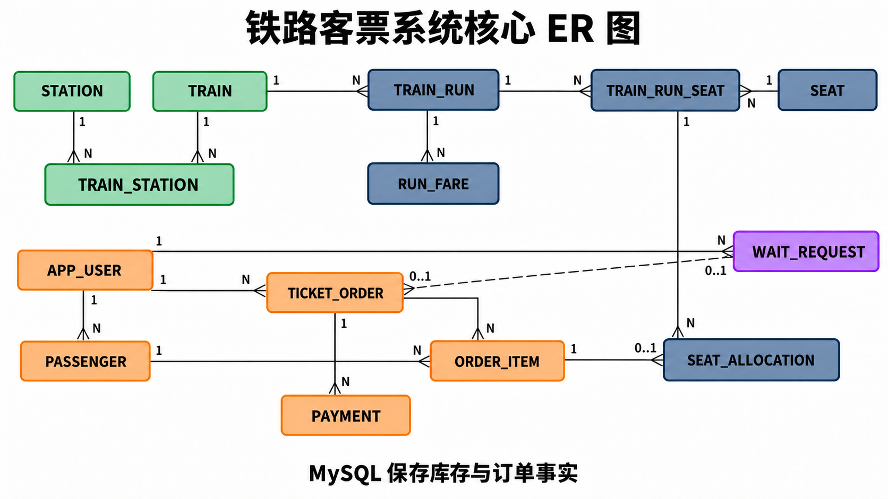

# 12306 数据库系统课堂汇报讲解材料

> 版本：5～10 分钟审阅稿  
> 推荐时长：8 分钟讲解，其中最后 2 分钟进行现场购票  
> 推荐页数：7 页，包含封面与现场演示  
> 汇报顺序：现实问题 → 真实 12306 → 我们的数据库 → 核心算法 → 事务与候补 → 现场购票

## 一、这一版要讲清楚什么

整场汇报只回答一个问题：

> **当很多人同时购买同一列车的不同区间时，数据库怎样判断一个座位还能不能卖，并保证它不会在重叠区间被重复出售？**

讲解中可以用 G8359 举例，但只把它作为数据模型和区间位图的例子。登录、查询和预订车票全部放在最后的现场演示中，不提前穿插界面操作。

## 二、时间与页面安排

| 页码 | 内容 | 推荐时间 | 这一页的结论 |
|---:|---|---:|---|
| 1 | 封面 | 15 秒 | 今天从数据库角度解释铁路订票 |
| 2 | 铁路票为什么难卖 | 60 秒 | 一张票占用的是座位的一段行程，不是简单扣减一个库存数字 |
| 3 | 真实 12306 的数据库架构 | 75 秒 | 交易、查询和分析需要分工，核心库存仍需强一致性 |
| 4 | 我们的数据库与 ER 图 | 90 秒 | `train_run_seat` 保存库存事实，订单和候补最终都落入同一套库存逻辑 |
| 5 | G8359 与区间位图 | 90 秒 | 位图可以快速判断区间冲突，并允许非重叠区间复用座位 |
| 6 | 并发购票、候补与流量缓冲 | 90 秒 | 行锁、事务、幂等和自动候补共同保证高并发下的正确性 |
| 7 | 现场预订 G8359 | 120 秒 | 用户操作能够在管理端观察到订单和库存的同步变化 |

推荐总时长约 8 分钟。若只能讲 5 分钟，第 3、4、6 页各压缩到 40 秒，现场演示只完成一次正常购票。若有 10 分钟，可在最后增加一次退票触发候补的演示。

## 三、详细页面内容和讲稿

## 第 1 页：封面

### 屏幕内容

**标题：铁路客票系统中的数据库设计**  
**副标题：区间库存、并发事务与候补队列**

画面保持简单，可使用一条铁路线路和一张电子车票作为背景，不放大段文字。

### 讲稿

大家平时使用 12306 时，看到的是查询、下单和支付几个页面。数据库真正需要解决的问题，是很多人同时购买同一趟列车、不同乘车区间时，怎样正确管理每一个座位。下面先看铁路库存和普通商品库存有什么不同。

### 转场

普通商品可以直接记录“还剩多少件”，但铁路座位不能只记录一个剩余数量。

## 第 2 页：铁路席位库存

### 屏幕内容

画一条四站线路：

`A站 ─ B站 ─ C站 ─ D站`

在同一个座位上标出：

- A 到 B 与 B 到 D 不重叠，可以分别出售；
- A 到 C 与 B 到 D 存在重叠，不能同时出售。

屏幕只保留一句结论：

> **铁路库存记录的是“座位在哪些区间已经被占用”。**

### 讲稿

假设一趟车经过 A、B、C、D 四站。同一个座位卖给一名 A 到 B 的旅客后，还可以继续卖给 B 到 D 的旅客，因为两段行程不重叠。但是如果已经卖出了 A 到 C，就不能再出售 B 到 D。由此可见，铁路库存不是一个简单的数量，而是座位在多个相邻区间上的占用状态。

当几万人同时查询和抢同一趟热门车时，系统既要快速回答“有没有票”，又要保证最后成交的数据完全正确。这构成了 12306 的主要数据库挑战。

### 转场

真实 12306 需要把高频查询和核心交易拆开处理，同时保证最终库存只有一个权威来源。

## 第 3 页：真实 12306 的数据库架构

### 屏幕内容

用一张简化架构图表达三层，不展示产品名称：

1. **渠道与查询层**：网站、手机、车站等渠道快速查询车次和余票；
2. **交易与席位层**：占座、订单、支付、退票和候补，保证事务一致性；
3. **数据与运维层**：同步、统计分析、监控、安全和灾备。

在图的一侧标注：

- 7.0 架构：双活中心与灾备中心；
- 席位分片：始发日期 + 始发车次 + 业务权重。

### 讲稿

公开论文显示，铁路客票系统从多级分布式体系继续向统一资源调度演进。7.0 架构提出双活中心和灾备中心，并把业务服务、数据能力、安全和运维分层建设。

关系型数据库仍然适合保存订单、支付和席位更新，因为这些操作要求事务和强一致性。高频余票查询、历史分析和日志处理则由更适合的查询或分析系统承担。也就是说，系统按照业务场景分配数据库职责，而不是让一个关系型数据库承担全部流量。

席位数据还要进行分片。论文提出以始发日期和始发车次为基本分片键，再考虑热门程度、开售时间、席位数、停站数和节点能力。原因很直接：不同车次产生的访问量和 OD 组合数差别很大，只按车次数量平均分配并不能实现负载均衡。

### 需要避免的表述

- 不要说真实 12306 使用了我们项目中的 MySQL、Neo4j 和 Redis 组合；
- 不要把论文中的设计方案全部描述成已经公开确认的现网产品；
- 数据规模必须带年份，5～10 分钟汇报中可以不讲具体数字。

### 转场

我们的课程项目没有复刻全国规模，但保留了铁路售票最核心的数据关系和一致性问题。

## 第 4 页：我们的数据库与核心 ER 图

### 屏幕内容

将下图作为本页主体，占据约 80% 的页面：



### 图中关系的讲解顺序

只按下面三条链路讲，不逐个念表名：

1. **车次与库存**：`TRAIN → TRAIN_RUN → TRAIN_RUN_SEAT`；
2. **用户与订单**：`APP_USER → TICKET_ORDER → ORDER_ITEM → SEAT_ALLOCATION`；
3. **候补转换**：`WAIT_REQUEST` 匹配成功后转换为普通 `TICKET_ORDER`。

### 讲稿

我们的数据库首先区分车次模板和每日运行实例。`TRAIN` 表示 G8359 这样的车次模板，`TRAIN_RUN` 表示它在 2026 年 10 月 7 日的具体运行。这样同一车次可以在不同日期拥有不同编组、票价和销售状态。

`TRAIN_RUN_SEAT` 是库存核心。它把一个具体运行实例和一个具体座位组合起来，并保存该座位已经占用的区间。用户提交订单后，`TICKET_ORDER` 保存订单头，`ORDER_ITEM` 表示每名乘车人的一张票，`SEAT_ALLOCATION` 记录最终分到的座位和占用区间。

候补没有另建一套库存。`WAIT_REQUEST` 匹配成功后调用与普通购票相同的占座过程，并转换为普通订单。这样普通购票与候补不会分别维护两份余票。

MySQL 是库存和订单的唯一事实来源。Neo4j 只负责生成直达或换乘路径候选，Redis 只负责唤醒后台订票工作者，两者都不能直接扣减库存。

### 转场

下面用 G8359 的南通西到上海虹桥区间，说明 `TRAIN_RUN_SEAT` 怎样保存席位状态。

## 第 5 页：G8359 与区间位图

### 屏幕内容

显示 G8359 的简化线路，只突出本次示例：

`盐城 … 南通西(5) ─ 张家港(6) ─ 常熟(7) ─ 太仓(8) ─ 上海虹桥(9) … 义乌`

右侧显示计算：

```text
乘车区间：[5, 9)
区间位图：11110000₂
十进制：240
```

底部保留两个判断：

```text
可售：(occupied_mask & 240) = 0
占座：occupied_mask = occupied_mask | 240
```

### 讲稿

G8359 共经过 14 个车站，形成 13 个相邻区间。南通西的停站序号是 5，上海虹桥是 9，因此这张票占用 5 到 6、6 到 7、7 到 8、8 到 9 四段。

系统用一个 64 位整数表示整条线路。南通西到上海虹桥对应的区间位图是二进制 `11110000`，十进制为 240。查询某个座位时，只需要把现有位图和请求位图做按位与。如果结果为零，说明没有重叠，这个座位可以出售；成交后用按位或把四个区间置为已占用。

退票时系统根据原订单保存的位图清除同样的区间。这样既能防止重叠销售，也能让同一座位继续出售不重叠的前后区间。

### 转场

位图解决了“怎样表示库存”，事务锁则解决“多人同时修改库存时由谁成功”。

## 第 6 页：并发购票、候补与流量缓冲

### 屏幕内容

显示一条从左向右的处理链：

`提交请求 → 持久化缓冲 → 幂等检查 → 锁定座位 → 位图复查 → 生成订单 → 支付确认`

下方增加两个返回分支：

- 无票：进入预支付候补；
- 退票或超时：释放区间并自动匹配候补。

### 讲稿

用户提交请求后，系统先把请求持久化到 `booking_request_buffer`。相同用户和幂等键只能出现一次，因此重复点击不会产生重复订单。Redis 列表通知后台工作者有新任务，但真正的请求记录已经保存在 MySQL 中，Redis 暂时不可用时也不会丢单。

工作者调用存储过程，在一个事务中计算区间位图，并使用 `SELECT ... FOR UPDATE` 锁定候选座位。取得锁后还要依据最新位图重新检查。多个用户同时看到最后一张票时，只有第一个完成锁定和更新的事务能够成功，其他事务会重新选择座位或进入候补。

候补已经预支付。退票、取消或支付超时释放库存后，系统自动扫描候补队列。队列以先到先得为基础，同时允许无法满足的大订单被有限跳过，避免一个大订单长期阻塞后面的请求。匹配成功后仍调用同一个事务占座过程。

### 本页一句话总结

> **页面提供余票快照，数据库事务决定最终成交。**

### 转场

前面的数据模型和事务逻辑，最后通过一次真实预订来验证。

## 第 7 页：现场演示 G8359 购票

### 演示目标

同学在线完成一张 **G8359 南通西到上海虹桥** 的车票预订，教师同时展示管理端中的订单和库存变化。

### 演示步骤

1. 用户输入姓名登录；
2. 出发城市选择“南通”，车站选择“南通西”；
3. 到达城市选择“上海”，车站选择“上海虹桥”；
4. 日期保持系统统一演示日 `2026-10-07`；
5. 查询后找到 G8359，确认 13:05 发车、14:30 到达；
6. 点击预订，选择乘车人、席别和座位偏好；
7. 提交并支付，在“我的车票”中查看电子车票；
8. 教师切换到管理端，展示订单流水和对应区间余票减少。

### 演示讲稿

现在开始实际预订。我们选择南通市的南通西站，目的地选择上海市的上海虹桥站。系统会把城市和车站条件转换为数据库中的站点集合，并按照列车停站顺序筛选正向运行的车次。

找到 G8359 后进入订单页面。提交时，页面显示的余票还不能直接决定成功，数据库会在事务中重新检查并锁定座位。支付成功后，“我的车票”显示具体车厢和座位；管理端同时出现这笔订单，G8359 南通西到上海虹桥区间的余票减少一张。

这次操作验证了前面讲到的完整链路：城市和车站查询、运行实例、区间位图、事务占座、订单支付以及监控对账。

### 10 分钟版本的可选追加演示

如果时间允许，教师预先用 AI 订票员把 G8359 某席别压到少量余票：

1. 多名同学同时提交，观察系统没有超卖；
2. 未取得座位的用户进入“候补中”；
3. 教师按南通西到上海虹桥区间随机退掉一张 AI 车票；
4. 候补队列自动兑现，管理端状态同步更新。

5 分钟版本不做这段追加演示，以免影响主线。

## 四、可直接连续讲述的 8 分钟讲稿

大家平时使用 12306 时，看到的是查询、下单和支付几个页面。数据库真正需要解决的问题，是很多人同时购买同一趟列车不同区间时，怎样正确管理每一个座位。

假设一趟列车经过 A、B、C、D 四站。同一个座位卖给 A 到 B 的旅客以后，还可以继续卖给 B 到 D 的旅客，因为两段行程没有重叠。但是如果已经卖出了 A 到 C，就不能再出售 B 到 D。因此铁路库存不是一个简单的剩余数量，而是座位在多个相邻区间上的占用状态。

真实 12306 还要面对节假日突发访问和热门车次的高度集中。公开论文中的 7.0 架构提出双活中心和灾备中心，并把业务服务、数据能力、安全和运维分层建设。关系型数据库继续负责订单、支付和席位更新，高频查询与历史分析则由更合适的系统分担。席位数据以始发日期和始发车次为基本分片键，并结合热度、开售时间、席位数和停站数进行负载均衡。

我们的课程项目保留了其中最关键的数据库问题。`TRAIN` 表示 G8359 这样的车次模板，`TRAIN_RUN` 表示它在 2026 年 10 月 7 日的实际运行。`TRAIN_RUN_SEAT` 把运行实例与具体座位组合起来，是库存核心。用户订单由 `TICKET_ORDER` 和 `ORDER_ITEM` 保存，最终分配结果写入 `SEAT_ALLOCATION`。候补成功后也转换为普通订单，因此普通购票和候补共用同一份库存。

以 G8359 南通西到上海虹桥为例。南通西是第 5 站，上海虹桥是第 9 站，这张票占用四个相邻区间。系统用一个 64 位整数保存区间状态，对应位图为二进制 `11110000`。查询时把已有位图和请求位图做按位与，结果为零表示没有冲突；成交时用按位或把这些区间置为已占用。退票则清除原订单对应的位。

多人同时购买时，系统先把请求持久化，并通过幂等键防止重复下单。存储过程在一个事务中锁定候选座位，取得锁后依据最新位图再次检查。这样即使多个用户同时看到最后一张票，也只有一个事务能够成功。无票请求可以进入预支付候补，退款或超时释放库存后，后台会自动匹配候补。

最后进行实际演示。我们登录用户端，选择南通西到上海虹桥，日期为 2026 年 10 月 7 日，在查询结果中找到 13:05 发车的 G8359。选择乘车人和席别后提交订单。支付成功后可以查看电子车票，管理端同时显示新的订单，相关区间余票减少一张。这说明从查询、位图占座、支付到监控的整条数据库链路已经完成。

## 五、课前检查清单

- 系统已启动，用户端和管理端可以分别访问；
- 测试用户、旧订单、支付、退款和候补记录已经清理；
- 所有演示车次日期为 `2026-10-07`；
- 南通西到上海虹桥能够搜索到 G8359；
- G8359 显示 13:05 发车、14:30 到达；
- 管理端已打开订单流水、车次库存和候补监控；
- 若追加候补演示，提前用 AI 订票员把指定席别压到 1～3 张余票；
- 演示结束后检查库存对账和订单金额对账的异常记录均为 0。

## 六、答辩可能追问

### 1. 为什么不用“剩余座位数”直接减一？

因为不同乘客购买的区间可能重叠，也可能不重叠。一个总数量无法表达座位在每个相邻区间上的占用状态，也无法支持同一座位的分段复用。

### 2. Redis 为什么不直接保存库存？

Redis 在本项目中负责快速唤醒工作者。请求、订单和库存事实先写入 MySQL，因此 Redis 故障不会造成已经提交的订单请求永久丢失。

### 3. Neo4j 为什么还要回到 MySQL 校验？

Neo4j 适合寻找站点之间的路径候选，但路径存在不代表当天一定开行，也不代表方向、换乘时间、票价和库存都满足条件。最终销售条件由 MySQL 校验。

### 4. 两个用户同时抢最后一张票会怎样？

两个请求都可能看到旧的余票快照，但事务会锁定具体座位行。第一个事务更新位图后，第二个事务读取到最新状态，不能再次占用同一重叠区间。

### 5. 候补为什么要调用普通占座过程？

如果候补另写一套扣票逻辑，就可能和普通购票产生竞争漏洞。共用同一个存储过程可以统一执行行锁、位图检查、幂等和审计规则。

## 七、资料来源

1. 阎志远，单杏花，游雪松，等：《铁路客票系统 7.0 架构设计》，《铁路计算机应用》，2024，33(8)：6-11。
2. 李杨，阎志远，朱建军，等：《铁路客票系统关系型数据库的困境和出路研究》，《铁路计算机应用》，2017，26(12)。
3. 王元媛，单杏花，游雪松，等：《铁路客票系统席位集中模式下的席位数据分片策略研究》，《铁路计算机应用》，2025，34(8)：7-11。
4. 项目数据库迁移、设计文档和当前运行实例。

视频可以用来帮助理解区间票额和 12306 的发展过程，但汇报中的架构结论以论文和项目实际实现为准。
