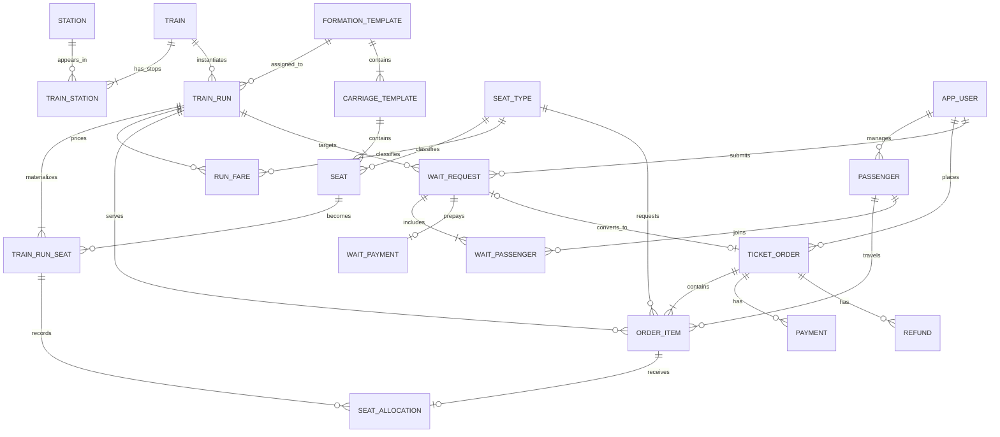

# 12306 数据库系统课堂汇报：讲解材料与详细大纲

> 版本：审阅稿（暂不制作 PPT）  
> 建议时长：讲解 30～35 分钟，实操 10～15 分钟，问答 5 分钟  
> 建议页数：22 页（含封面和总结）

## 一、汇报的核心叙事

整场汇报围绕一个问题展开：

> **当大量用户同时购买同一列车的不同乘车区间时，系统怎样既快速响应，又保证同一个席位不会在重叠区间被重复出售？**

第一部分说明真实铁路客票系统为什么难，以及公开论文中的架构演进；第二部分把问题缩小到课程项目，说明我们保留了哪些核心不变量、如何用数据库实现；第三部分让同学实际预订 G8359“南通西—上海虹桥”，把搜索、占座、支付、候补、退票和监控串成一次可观察的实验。

需要始终强调边界：我们的系统是依据公开论文抽象出的**教学实现**，不是对真实 12306 源码或现网架构的复刻。真实系统的产品与部署细节只采用论文和官方公开报道中能够确认的部分。

## 二、简明大纲

| 版块 | 建议时间 | 要回答的问题 | 讲完后的结论 |
|---|---:|---|---|
| 1. 真实 12306 与数据库挑战 | 13～15 分钟 | 为什么普通电商库存模型不够用？关系型数据库遇到了什么困境？7.0 架构和席位分片解决什么问题？ | 12306 的核心不是“网页抗并发”，而是多渠道、高峰流量下的席位强一致性、热点均衡和灾备能力 |
| 2. 我们的数据库与系统 | 17～20 分钟 | 数据如何建模？余票如何表示？怎样防超卖、候补、退款、削峰、查联程？ | MySQL 保存交易事实，区间位图表达席位，事务锁保证正确性，Redis 只负责唤醒，Neo4j 只生成路径候选 |
| 3. G8359 课堂实操 | 10～15 分钟 | 同学如何完成购票？管理员能观察到什么？怎样制造并验证候补兑现？ | 一次真实操作可以同时验证城市/车站查询、原子占座、库存变化、候补匹配和退款释放 |

## 三、讲解材料：真实 12306 应讲清楚的六个观点

### 1. 铁路票不是普通的“商品库存”

一件普通商品通常只有“剩余数量”；铁路席位还带有运行区间。同一座位可以先卖 A→B，再卖 B→D，但不能同时卖 A→C 和 B→D。系统面对的不是单个整数扣减，而是“列车—日期—席位—区间”的组合约束。

这也是视频《抢不到火车票，真的是你手速慢吗？》可以作为开场引子的原因：全程票仍有余票而中间区间暂时无票，背后是票额策略、区间复用和后续需求之间的权衡，而不只是页面刷新速度。

### 2. 高并发只是表象，热点和正确性才是核心

春运开售带来突发流量，但请求并不均匀：少数热门日期、车次、区间会成为热点。缓存能够挡住查询，却不能独自决定最后一张票属于谁。真实挑战包括：

- 查询量远高于实际成交量；
- 热门车次的访问高度倾斜；
- 订单、支付、退票和候补都会修改同一份席位事实；
- 多个渠道必须看到可解释、最终一致的状态；
- 任何故障恢复都不能制造重复订单或重复扣票。

中国铁科院 2024 年公开报道提到，研发团队采用异步交易排队、分布式内存计算和混合云等方法应对海量高并发访问；报道给出的量级是单日最高访问量超过 500 亿次、高峰每秒出票 1000 多张。引用这些数字时必须注明“2024 年官方报道口径”，不要与论文中的历史数据混用。

### 3. 从“物理分散、逻辑集中”到“两地三中心”

2017 年论文描述了国铁中心、区域中心和车站构成的多级分布式架构；2024 年的 7.0 架构论文进一步提出“两地三中心”，优化双活中心，并建设灾备中心。这个演进解决的不只是扩容，还包括：

- 缩短和规范数据同步链路；
- 提升关键业务的双活和灾备接管能力；
- 统一资源调度，减少低利用率的分散建设；
- 缩小安全边界，增强网络、密码和个人信息保护；
- 让研发、测试、发布、监控和应急处置形成一体化体系。

讲解 7.0 架构时，建议使用“总体架构—网络架构—逻辑架构—安全—研发运维”五层视角，而不是只画若干服务器。

### 4. 关系型数据库没有“过时”，而是需要重新划分职责

2017 年论文总结的困境包括：商业数据库和专用硬件成本高、密集查询和复杂关联压力大、横向扩展困难、业务对存储过程和厂商特性耦合较深，以及日志和历史订单分析规模持续增长。

正确结论不是“关系型数据库不适合 12306”，而是：

- 核心订单、支付和席位更新仍需要 ACID 事务；
- 高频余票读取适合内存计算或专门的查询层；
- 历史订单、日志和营销分析适合分布式分析系统；
- 路径搜索、推荐等关系密集问题可使用图或搜索系统；
- 不同存储承担不同任务，但必须明确谁是最终事实来源。

这种设计常被概括为“多模型数据库”或“按场景选择存储”。

### 5. 席位分片不能只看“车次编号”

2025 年席位分片论文指出，负载不仅受车次数量影响，还受开售并发、热门程度、席位数和停站数影响。停站越多，可售 OD 组合越多，席位计算和存储压力越大。

论文提出以“始发日期 + 始发车次”为基本分片原则，再加入开售时间、热度、节点能力、停站数等业务权重，并比较两种模式：

- **分类模式**：席位数据与席位管理数据分开分片，迁移灵活、可独立扩容，但应用层要处理更多一致性问题；
- **混合模式**：相关数据放在统一集群，事务简单，但扩容和迁移粒度更大。

这页的重点不是背名词，而是说明：分片键必须贴合业务热点，否则“平均分车次”仍会产生严重倾斜。

### 6. 缓存、队列和分片都不能替代库存事实

可以把真实售票链路抽象为：

1. 查询层快速返回候选车次和余票快照；
2. 排队或限流层吸收瞬时峰值；
3. 交易层重新校验库存并取得写入权；
4. 在同一事务中写订单、占座和审计事实；
5. 支付、超时、退款、候补通过明确状态机继续驱动库存变化。

页面上的“有票”只是某一时刻的读模型；真正能否成交必须由交易层的原子操作决定。

## 四、真实系统与课程项目的对应关系

| 真实问题 | 公开资料中的思路 | 我们的教学实现 |
|---|---|---|
| 同一席位可按区间复用 | 席位数据按车次、日期和运行区间管理 | `train_run_seat.occupied_mask` 以 64 位位图保存区间占用 |
| 热门车次最后一张票竞争 | 核心交易保持强一致 | MySQL 事务、`SELECT ... FOR UPDATE`、条件更新和整体回滚 |
| 重复点击、网络重试 | 交易请求必须可重放 | `(user_id, idempotency_key)` 唯一约束，重复请求返回原结果 |
| 瞬时峰值 | 异步排队、分布式内存计算 | MySQL 持久化请求缓冲 + Redis 阻塞唤醒 + 多工作者消费 |
| 无票后的需求承接 | 候补队列与退票兑现 | 预支付候补、自动匹配、有限跳过和公平保护 |
| 路网与换乘查询 | 查询与交易职责分离 | Neo4j 生成路径候选，MySQL 校验日期、方向、换乘时间、票价和余票 |
| 数据正确性难以观察 | 集中监控和审计 | 库存/金额对账视图、订单和库存事件、管理端实时监控 |
| 多数据中心负载倾斜 | 日期+车次基础分片，业务权重驱动 | 当前单库未实施分片，但数据模型已以 `run_id` 隔离运行实例，可作为后续分片键 |

## 五、我们系统的核心 ER 图

PPT 上建议只画核心实体，审计、管理登录和请求缓冲放到右侧“辅助对象”框中，否则一页会过密。

辅助对象：

- 审计：`order_event`、`inventory_event`、`wait_request_event`；
- 运维：`v_inventory_reconciliation`、`v_order_amount_reconciliation`、`v_booking_buffer_monitor`；
- 安全：`admin_user`、`admin_session`；
- 削峰：`booking_request_buffer`；
- 静态辅助：`train_segment`、`station_pair_distance`、`fare_rule`。

当前本机数据库实测有 29 张基础表、6 个视图、17 个函数/存储过程、3 个触发器。

## 六、22 页 PPT 的详细内容与讲稿

### 第 1 页：封面

**标题**：从 12306 到我们的铁路客票系统  
**副标题**：高并发下的区间库存、事务一致性与候补队列  
**画面**：简洁铁路线路图 + CR 标识 + G8359 电子票局部。

**讲稿**：今天不从页面功能开始，而从数据库最难的问题开始：当很多人同时购买同一趟车不同区间时，系统如何知道某个座位到底还能不能卖，并保证最后一张票不会卖给两个人？

### 第 2 页：一个反直觉现象

**屏幕内容**：A—B—C—D 四站示意图；同一座位的 A→B 和 B→D 可以同时出售，A→C 和 B→D 不可以。  
**画面**：一张座位沿线路被不同颜色区间覆盖的示意图。

**讲稿**：普通商品库存可以用一个整数表示，铁路席位必须同时考虑起点、终点和区间重叠。因此用户看到“全程有票、短途无票”，不一定是系统错误，也可能来自区间库存和票额策略。这一页用于把全场问题具体化。

### 第 3 页：12306 为什么难

**屏幕内容**：突发流量、热点倾斜、区间复用、强一致交易、多渠道同步、故障恢复。  
**画面**：六边形挑战图，中间写“席位事实”。

**讲稿**：高并发不是唯一难点。真正困难的是热点非常集中，同时订单、支付、退票、候补都要修改同一份席位事实。查询可以缓存，最终成交不能靠过期快照；系统还必须在故障和重试下保持幂等。

### 第 4 页：公开资料中的规模与演进

**屏幕内容**：

- 2016 年论文历史口径：5000 余车站、年售票 32 亿张；
- 2024 年官方报道口径：单日最高访问量超过 500 亿次、高峰每秒出票 1000 多张；
- 从多级分布式体系演进到 7.0 的统一资源和灾备设计。

**讲稿**：这些数字来自不同年份，只用于说明数量级，不能直接横向相加。系统演进的主线，是从“能联网售票”走向“统一调度、双活灾备、智能运维和快速迭代”。

### 第 5 页：7.0 总体架构——两地三中心

**屏幕内容**：双活中心 + 灾备中心；业务流、数据同步流、灾备接管流。  
**画面**：重绘论文结构，不直接截图堆字。

**讲稿**：双活中心承担主要业务，灾备中心保存备份并承担查询、统计等任务；极端情况下，灾备中心可以提供降级接管能力。这里的关键词不是“多建一个机房”，而是统一资源、缩短同步链路、明确故障切换路径。

### 第 6 页：7.0 逻辑架构——纵向解耦、横向融合

**屏幕内容**：硬件支撑、技术支撑、服务赋能、业务中心、渠道应用/用户；旁边放安全体系和研发运维体系。  
**讲稿**：渠道不应该直接绑死底层数据库。业务能力通过统一接入、服务中心、数据和 AI 赋能平台复用；安全和运维贯穿各层。这是比“前端—后端—数据库”更完整的企业架构视角。

### 第 7 页：关系型数据库的困境与出路

**屏幕内容**：左侧“核心交易擅长”，右侧“密集查询/分析受限”，中间箭头“按场景拆分”。  
**讲稿**：关系型数据库擅长事务、约束和一致性，但不适合独自承担所有密集查询、历史分析和关系搜索。论文的答案不是抛弃关系型数据库，而是保留其作为核心交易底座，把查询、日志和分析交给更合适的系统。

### 第 8 页：席位数据怎样分片

**屏幕内容**：分片键 = 始发日期 + 始发车次 + 业务权重；权重包括热度、开售时间、席位数、停站数、节点容量。  
**画面**：三台节点，热门长编组车次与普通车次按权重均衡分配。

**讲稿**：平均分配车次数不等于平均分配负载。一趟 14 个站的车比两站直达车产生更多 OD 组合。分类模式更灵活，混合模式事务更简单；选择取决于扩容迁移和一致性成本之间的权衡。

### 第 9 页：真实售票的抽象交易链路

**屏幕内容**：查询快照 → 限流/排队 → 交易重检 → 原子占座 → 支付/超时/退款 → 审计。  
**讲稿**：用户看到“有票”后，提交时仍要重新校验，因为在两次操作之间别人可能已经买走。缓存负责快，事务负责真；队列负责平滑流量，但不拥有库存。

### 第 10 页：从真实系统到课程项目

**屏幕内容**：保留四个不变量——区间不重叠、订单原子性、请求幂等、变化可审计。  
**讲稿**：我们没有复刻全国规模，也没有实现真实实名和支付平台；但我们保留了最值得学习的数据库问题。后面所有表、过程和界面，都围绕这四个不变量设计。

### 第 11 页：我们的系统总体架构

**屏幕内容**：用户端/管理端 → Python API → MySQL；Neo4j 路径候选；Redis 唤醒；后台工作者。  
**讲稿**：MySQL 是唯一交易事实来源。Neo4j 可以告诉我们“可能怎么走”，但最终仍由 MySQL 校验日期、方向、换乘时间、票价和余票。Redis 只告诉工作者“有新请求”，即使 Redis 暂时不可用，MySQL 中的请求也不会丢失。

### 第 12 页：ER 图——五个数据域

**屏幕内容**：使用本文第五部分的核心 ER 图，用五种浅色区分静态路网、运行编组、订单交易、候补、审计运维。  
**讲稿**：先看静态模板，再看每日运行实例。`train` 是 G8359 这种车次模板，`train_run` 才是 2026-10-07 当天可以售卖的实例。具体座位被物化为 `train_run_seat`；订单项通过 `seat_allocation` 连接到运行席位。候补成功后仍转换为普通订单，不另建一套库存。

### 第 13 页：静态模板、运行实例与 G8359

**屏幕内容**：

- G8359：盐城—义乌，共 14 站、13 个相邻区间；
- 演示区间：南通西（序号 5）13:05 → 上海虹桥（序号 9）14:30；
- 演示日期：2026-10-07；
- 当前实例：218 个席位、273 条 OD×席别票价记录。

**讲稿**：新增车次不是只插一行 `train`。还要补充车站与城市归属、停站模板、相邻区间、运行实例、编组席位和 OD 票价。这样 G8359 才能和其他车次一样被搜索、购买、监控和 AI 压测。

### 第 14 页：城市/车站搜索怎样落到数据库

**屏幕内容**：城市“南通”展开为海安、如皋南、南通西等站；城市“上海”展开为上海、上海虹桥、练塘等站；按车上序号判断方向。  
**讲稿**：用户可以选城市，也可以选具体车站。城市搜索先展开候选站，再寻找同一运行实例中“起点序号小于终点序号”的组合，最后按实际发车时间排序。选择南通西和上海虹桥时，G8359 的 5→9 区间满足条件。

### 第 15 页：区间位图——一行数据表示整条线路占用

**屏幕内容**：`fn_segment_mask(5,9) = 0b11110000 = 240`；冲突条件 `(occupied_mask & request_mask) != 0`。  
**画面**：G8359 第 5～9 站之间四段点亮。

**讲稿**：南通西到上海虹桥占用 5→6、6→7、7→8、8→9 四个相邻区间。只要按位与为零，这个席位全程可用；成交后用按位或置位，退票用按位与非清位。位图把多行区间检查压缩成一次整数运算，同时保留非重叠区间复用能力。

### 第 16 页：怎样保证最后一张票不超卖

**屏幕内容**：幂等键 → 计算掩码 → 固定顺序锁定席位行 → 再检位图 → 写订单/分配/事件 → 提交。  
**讲稿**：`sp_create_order_hold` 在事务中使用 `SELECT ... FOR UPDATE` 锁住候选席位，只有拿到锁的事务才能依据最新位图占座。多人订单必须全部分配成功，否则整体回滚。固定加锁顺序降低死锁概率，死锁时应用可以重试；重复点击则由幂等键返回原订单。

### 第 17 页：订单、支付与退款状态机

**屏幕内容**：`PENDING_PAYMENT → PAID`；旁路 `CANCELLED/TIMEOUT/REFUNDED`；席位 `HOLD → CONFIRMED → RELEASED`。  
**讲稿**：订单状态和席位状态必须同步变化。超时、取消和退款都依据原始 `segment_mask` 精确释放区间，并写入不可变事件。乘车人时间冲突触发器会锁定乘车人行，防止两个并发订单同时绕过时间重叠检查。

### 第 18 页：候补不是一个普通列表

**屏幕内容**：预支付 → `WAITING` → `MATCHING` → `MATCHED_HOLD` → `FULFILLED`；过期/取消/失败退款。  
**讲稿**：候补按创建时间和编号形成基本 FIFO，但小订单可以有限跳过暂时无法满足的大订单；被跳过达到阈值后进入公平保护。退票释放库存会立即触发匹配，后台线程还会补偿扫描。兑现调用同一个占座过程，因此不会绕过库存锁。

### 第 19 页：数据库缓冲区与 Redis

**屏幕内容**：请求先持久化到 `booking_request_buffer`；Redis 列表只推送请求编号；工作者用租约领取；失败可重新入队。  
**讲稿**：系统把瞬时请求先写入 MySQL，唯一约束保证幂等。多个工作者用 `FOR UPDATE SKIP LOCKED` 领取不同任务，`lease_owner + lease_until` 支持崩溃恢复。Redis 的阻塞读取减少空轮询，但不是订单或库存事实来源；Redis 宕机时可退化为 MySQL 轮询。

### 第 20 页：图数据库、监控与对账

**屏幕内容**：Neo4j 路径候选 → MySQL 二次验证；管理端展示车次库存、订单、乘客、候补、缓冲队列；两个对账视图当前异常数均为 0。  
**讲稿**：图数据库适合表达站点和运行边，生成直达或换乘候选；但图投影可以重建，不能决定扣票。管理端则把数据库状态变成可观察证据。当前数据库实测库存位图对账和订单金额对账的不一致记录都为 0。

### 第 21 页：课堂实操——预订 G8359

**屏幕内容**：

1. 登录用户端；
2. 出发选择“南通—南通西”；
3. 到达选择“上海—上海虹桥”；
4. 日期保持 2026-10-07；
5. 在结果中找到 G8359（13:05—14:30）；
6. 选择席别和乘车人，提交并查看电子车票。

**讲稿**：完成标准不是只看到“支付成功”，而是“我的车票”中出现唯一车票，管理端订单流水增加，G8359 的对应区间余票减少，且其他不重叠区间仍可复用该席位。

### 第 22 页：并发小实验与总结

**屏幕内容**：老师用 AI 订票员把 G8359 南通西—上海虹桥某席别压到少量余票；同学同时购买；未成功者进入候补；随机退掉两张票；观察自动兑现。  
**总结句**：**查询可以近似，交易必须准确；缓存可以失效，事实不能丢；扩展能力来自正确的数据边界。**

**讲稿**：这个实验把全部设计串起来：页面快照会变化，但不会超卖；无票请求进入预支付候补；退票释放位图后自动匹配；监控端能看到订单、库存和候补状态变化。最后请同学解释：如果没有行锁、幂等键或区间位图，分别会出现什么错误？

## 七、实操环节的教师脚本

### 课前准备

1. 启动 MySQL、Neo4j、Redis 和 Web 服务；
2. 使用项目清理脚本删除测试用户、订单、支付、退款和候补记录，不删除基础车次和库存模板；
3. 验证所有车次统一为 2026-10-07；
4. 验证 G8359 可从南通西搜索到上海虹桥；
5. 打开管理端的车次库存、订单流水、候补队列和缓冲监控四个页面；
6. 准备一台投影设备展示监控端，学生设备只进入用户端。

### 第一轮：正常购票（3～5 分钟）

- 每名同学以自己的课堂昵称登录；
- 搜索“南通西—上海虹桥”；
- 只预订 G8359；
- 可自由选择商务座、一等座或二等座；
- 在“我的车票”中确认车次、区间、席别、车厢和座位号。

教师同步指出：订单流水新增、同一区间余票下降、电子票信息来自订单快照而不是当前票价表。

### 第二轮：最后几张票竞争（3～5 分钟）

- 教师使用 AI 订票员，指定 G8359、南通西—上海虹桥、二等座，先批量占用大部分库存；
- 保留 3～5 张二等座，让同学同时提交；
- 观察成功人数不会超过实际余票，失败用户转入预支付候补；
- 在管理端展示请求缓冲的领取、完成与失败状态。

### 第三轮：退票与候补兑现（3～5 分钟）

- 教师按相同区间随机选择两名 AI 用户退票，或让两名已购票同学主动退票；
- 观察相应区间位图被释放；
- 候补队列自动匹配，不手工点击“开始筛选”；
- 成功者状态从“候补中”转为“候补成功/已支付”，未到条件者继续等待；
- 再次检查库存对账和金额对账均无异常。

### 实操验收问题

1. 为什么同一个座位可以被不同乘客购买两段不重叠行程？
2. 为什么页面显示“有票”后仍可能进入候补？
3. Redis 停止后，为什么已经提交的订单请求不应该丢失？
4. Neo4j 找到一条换乘路径后，为什么还必须回到 MySQL 校验？
5. 两个用户同时购买最后一张票，数据库靠什么决定唯一赢家？

## 八、后续制作 PPT 时的视觉建议

- 第一部分用“问题—架构—分片”三类图，不要连续堆论文截图；
- 7.0 架构图依据论文重绘并在页脚标注来源；
- ER 图按数据域上色，核心库存表 `train_run_seat` 使用强调色；
- 位图页使用 G8359 14 个站的水平线路，点亮第 5～9 站之间的四段；
- 状态机页只保留主状态和异常出口，不把全部字段放到屏幕；
- 实操页使用真实界面截图，并在右侧放“用户操作—数据库变化—监控证据”三列；
- 每页只保留一个结论，详细说明放演讲者备注。

## 九、容易讲错的地方

1. 不要说“真实 12306 使用了我们这套 MySQL + Neo4j + Redis 架构”；这是我们的教学实现。
2. 不要说“缓存中显示有票就一定可以买到”；最终结果由事务重检决定。
3. 不要说“Redis 保存了订单”；请求和订单事实先落 MySQL，Redis 只是唤醒层。
4. 不要说“Neo4j 负责扣票”；它只做路径候选，MySQL 才是权威数据源。
5. 论文中的数字必须带年份；2016 年、2024 年和 2025 年的口径不能混在一起。
6. 7.0 论文描述的是架构设计和建设思路，讲解时避免把所有设计细节表述为已经公开确认的现网产品清单。

## 十、参考资料

### 核心论文

1. 阎志远，单杏花，游雪松，等：《铁路客票系统 7.0 架构设计》，《铁路计算机应用》，2024，33(8)：6-11。
2. 李杨，阎志远，朱建军，等：《铁路客票系统关系型数据库的困境和出路研究》，《铁路计算机应用》，2017，26(12)。
3. 王元媛，单杏花，游雪松，等：《铁路客票系统席位集中模式下的席位数据分片策略研究》，《铁路计算机应用》，2025，34(8)：7-11，DOI：10.3969/j.issn.1005-8451.2025.08.02。

### 补充材料

- 中国铁道科学研究院：《12306 背后的“技术大脑”》，2024-12-09：<https://www.rails.cn/content.php?contentid=65601&page=11>
- MySQL 8.4 Reference Manual：Locking Reads：<https://dev.mysql.com/doc/refman/8.4/en/innodb-locking-reads.html>
- MySQL 8.4 Reference Manual：Deadlock Handling：<https://dev.mysql.com/doc/refman/8.4/en/innodb-deadlocks-handling.html>
- Redis 官方文档：Lists：<https://redis.io/docs/latest/develop/data-types/lists/>
- Neo4j Cypher Manual：Shortest Paths：<https://neo4j.com/docs/cypher-manual/current/patterns/shortest-paths/>
- 视频《抢不到火车票，真的是你手速慢吗？【差评君】》：<https://www.bilibili.com/video/BV1T1cvzYE9V>
- 视频《12306，中国最硬核的 APP 之一【大国之治·12306】》：<https://www.bilibili.com/video/BV1vraH6iEZ2>

视频适合作为故事化补充，不应替代论文和官方资料作为架构事实来源。
